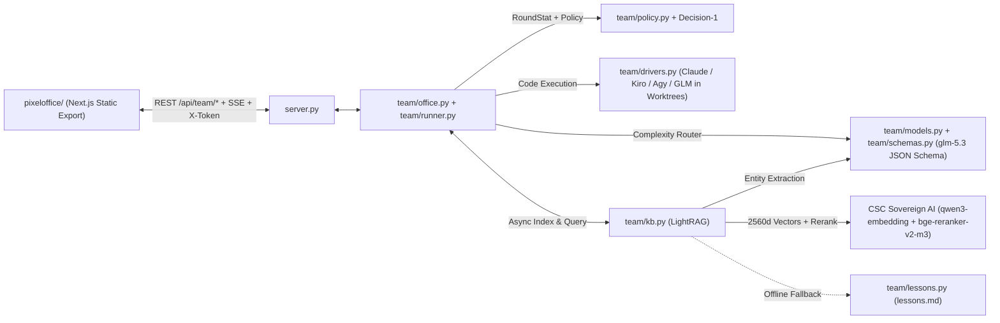

## Goal Capsule

- **Objective:** Deliver a single-UI, deterministic-output, cross-project-learning Pixel Office (`buttonAuto` v2) where paid coding CLIs and free `glm-5.3` / `Decision-1` models execute isolated tasks without silent JSON parsing failures, uncalibrated scoring, or UI split.
- **Means:** Re-architect the dual-engine backend around strict JSON Schema contracts, `glm-5.3` + `Decision-1` task-complexity routing, LightRAG knowledge retrieval (`qwen3-embedding` + `bge-reranker-v2-m3`), and retire the legacy `web/console/` UI in favor of a single exception-first `pixeloffice/` Next.js interface.
- **Authority:** User approved Plan B (full dual-engine rearchitecture + single PixelOffice UI) and selected `qwen3-embedding` during this brainstorm; existing safety invariants in `CLAUDE.md` and `docs/superpowers/specs/2026-11-17-autonomy-roles-capabilities-design.md` remain binding.
- **Execution Profile:** `execution: code` (Python backend in `team/` + Next.js/Tailwind frontend in `pixeloffice/`).
- **Stop Conditions:** Never auto-merge worktrees; never store or log API keys outside gitignored local config (`litellm.local.json`, `secrets.local.json`); never route reasoning to Ollama, `gemma`, or `muse-glimmer`.
- **Open Blockers:** None (all product scope decisions settled; enriched in place from brainstorm).

---

## Product Contract

> **Product Contract preservation:** Product Contract unchanged (R1–R8, NG1–NG3, KTD1–KTD4, F1–F3, AE1–AE3 preserved verbatim).

### Summary

`buttonAuto` v2 consolidates the multi-CLI orchestrator onto two strict execution contracts: deterministic structured outputs (`json_schema` on `glm-5.3` plus `Decision-1` probabilities) and a unified exception-first `pixeloffice/` frontend. It replaces regex JSON scraping (`extract_json`, `parse_opinion`) and flat per-repo `lessons.md` injection with schema-enforced model calls and a LightRAG knowledge engine powered by CSC Sovereign AI (`qwen3-embedding` + `bge-reranker-v2-m3`), while preserving the `RoundStat` progress loop, L1–L4 escalation ladder, and git worktree isolation.

### Problem Frame

Current `buttonAuto` runs rely on regex-based JSON extraction (`ai_client.py`, `team/models.py`), maintain two competing web UIs (`web/console/` and `pixeloffice/`), and limit project memory to the latest 20 single-line notes in `team/lessons.py`. Meanwhile, external multi-agent proposals introduce uncalibrated 0–100 weighted LLM scoring, bloated C-suite agent hierarchies, and Ollama dependencies that do not exist in this environment. Without enforcing machine-verifiable schemas, unifying the UI around human exception handling, and upgrading cross-project retrieval, autonomous rooms remain brittle on edge-case outputs and blind to lessons learned in sibling repositories.

### Actors

- A1. **Operator (User):** Assigns project goals, resolves escalated exceptions (permissions, stuck rooms, merges) in the unified Inbox, and approves final merges.
- A2. **Paid Coding CLIs (Claude, Kiro, Antigravity):** Execute code edits and tests inside isolated git worktrees via `team/drivers.py`.
- A3. **Free Sovereign / LiteLLM Models (`glm-5.3`, `Decision-1`):** Handle task decomposition, diagnostics, code/QA review, and permission probability checks without Ollama.
- A4. **Knowledge & Retrieval Service (`qwen3-embedding`, `bge-reranker-v2-m3`):** Vectorizes, indexes, and reranks cross-project lessons and architecture decisions on the CSC Sovereign AI endpoint.

### Requirements

- R1. All `glm-5.3` structured decision calls (Tech Lead diagnostics, Reviewer verdicts, PO acceptance breakdown, Lesson condensation) must enforce `response_format` JSON Schema with at most one schema-repair retry before failing closed.
- R2. Permission and gate decisions must combine deterministic checks (`RoundStat`, test results, `team/policy.py` scope/deny rules) with `Decision-1` (`/v1/systemone`) probabilities, rejecting uncalibrated 0–100 weighted LLM scoring formulas.
- R3. Task routing must assign work by task complexity (routing summaries, initial reviews, and small diagnostics to `glm-5.3` / `Decision-1`, reserving paid CLIs for complex implementation and debugging) rather than waiting for paid quota exhaustion.
- R4. The knowledge base must replace flat `lessons.md` truncation with LightRAG indexing and retrieval using `qwen3-embedding` (2560d) and `bge-reranker-v2-m3`, falling back gracefully to local lesson text if the Sovereign AI endpoint is unreachable.
- R5. All reasoning, entity extraction, and text generation inside LightRAG and orchestrator roles must run exclusively on `glm-5.3` (no Ollama, `gemma`, or `muse-glimmer`).
- R6. The legacy `web/console/` UI must be retired and all room management, Inbox action cards, `RoundStat` timelines, and budget/usage views consolidated into `pixeloffice/`.
- R7. The `pixeloffice/` layout must prioritize an always-visible Exception Inbox and summary bar (`Running | Needs You | Stuck`) with one-click action cards (`Approve`, `Retry`, `Merge`, `Copy Diagnostic Bundle`), keeping the pixel office canvas as ambient status.
- R8. All API keys (LiteLLM and CSC Sovereign AI) must remain exclusively in gitignored local config files and be stripped from prompts, logs, events, LightRAG documents, and diagnostic bundles.

### Non-Goals

- NG1. Do not implement simulated C-suite management agents (CEO/COO/CTO/CFO/CIO) that hold multi-agent meetings; keep scheduling, budgeting, and retrieval as deterministic Python modules.
- NG2. Do not auto-merge git worktrees under any autonomy setting.
- NG3. Do not introduce Ollama or external cloud vector databases that send code/lessons outside the local or CSC Sovereign AI boundary.

### Key Decisions

- KTD1. `session-settled:` Adopt Plan B (full dual-engine rearchitecture: retire `web/console/`, unify on `pixeloffice/`, replace `lessons.md` core with LightRAG, enforce JSON Schema across `glm-5.3` calls).
- KTD2. `session-settled:` Use `qwen3-embedding` (2560d, `/v1/embeddings`) paired with `bge-reranker-v2-m3` (`/v1/rerank`) on CSC Sovereign AI (`http://172.16.249.171:31305`) for LightRAG, with `glm-5.3` as the sole LLM for extraction and synthesis.
- KTD3. `session-settled:` Reject the external proposal's 6-dimension weighted scoring formula and Ollama dependency in favor of deterministic evidence gates (`RoundStat` + L1–L4 ladder) and `Decision-1` probabilities.
- KTD4. Prioritize Exception-First UX in `pixeloffice/` so the pixel canvas never obscures `stuck`, `permission`, or `merge` items requiring human intervention.

### Key Flows

- F1. Schema-Enforced Role Decision
  - **Trigger:** Any orchestrator role (`po`, `tech_lead`, `reviewer`, `qa`) invokes `glm-5.3`.
  - **Actors:** A3
  - **Steps:** Router attaches the role's strict JSON Schema (`response_format`); response is validated against the schema; on validation failure, a single targeted repair prompt is sent; if still invalid, the turn fails closed without advancing state.
  - **Covered by:** R1, R2

- F2. Cross-Project Lesson Capture & Retrieval
  - **Trigger:** A room hits `stuck` (L2+ diagnosis) or completes verification (`done`).
  - **Actors:** A3, A4
  - **Steps:** `glm-5.3` outputs a schema-validated lesson record (category, error fingerprint, root cause, fix); LightRAG asynchronously indexes it using `qwen3-embedding`; new rooms query LightRAG + `bge-reranker-v2-m3` at task start to inject top relevant cross-project pitfalls.
  - **Covered by:** R4, R5, R8

- F3. Exception-First Operator Intervention
  - **Trigger:** A room transitions to `waiting_user` (`permission`, `merge`, `stuck`, `login`).
  - **Actors:** A1
  - **Steps:** `pixeloffice/` updates the top summary strip and pins an action card in the Exception Inbox showing the exact gate failure, evidence, and one-click resolution buttons; the pixel canvas reflects the paused state ambiently.
  - **Covered by:** R6, R7

### Acceptance Examples

- AE1. **Schema Failure Isolation**
  - **Covers:** R1
  - **Given:** `glm-5.3` returns malformed JSON or missing required fields for a Reviewer verdict.
  - **When:** The model router validates the response against the Reviewer JSON Schema.
  - **Then:** The router performs at most one schema-repair retry and, if still invalid, surfaces an explicit validation error rather than falling back to regex scraping or advancing the task.

- AE2. **Cross-Project LightRAG Retrieval**
  - **Covers:** R4, R5
  - **Given:** Project A recorded a Windows TLS certificate failure lesson indexed via `qwen3-embedding`.
  - **When:** Project B starts a room encountering a matching TLS error or environment setup.
  - **Then:** LightRAG retrieves and `bge-reranker-v2-m3` ranks the Project A lesson into Project B's context without calling Ollama or leaking API keys.

- AE3. **Single-UI Exception Handling**
  - **Covers:** R6, R7
  - **Given:** Three rooms are running in parallel and one hits `stuck` at L4.
  - **When:** The operator opens `pixeloffice/`.
  - **Then:** The top summary bar highlights `Stuck: 1`, the Exception Inbox displays the root-cause card with a one-click `Copy Diagnostic Bundle` and `Retry` action, and `web/console/` is no longer required.

---

## Planning Contract

### Key Technical Decisions

- KTD5. **Schema-First Adapter with One-Shot Repair:** Introduce Pydantic models in `team/schemas.py` generating strict JSON Schemas for `glm-5.3`; if LiteLLM/upstream rejects `strict: true` or returns invalid JSON, fall back once to `json_object` + explicit schema-repair prompt, and fail closed on second failure.
- KTD6. **Non-Blocking LightRAG Sidecar Storage:** Store a single shared LightRAG graph and vector index under the orchestrator root `sessions/kb/` (gitignored, NOT inside target project worktrees) using `qwen3-embedding` (2560d) and `bge-reranker-v2-m3`; serialize all writes through a single-writer async queue, tag documents with `[project:<repo_id>] [room:<room_id>]` and deduplicate by `(repo_id, fingerprint)` so parallel rooms never race or pollute sibling projects, and degrade to `LessonBook.format_for_prompt` on network/timeout errors.
- KTD7. **Parity-First UI Cutover:** Rewire `pixeloffice/lib/api.ts` from legacy `/api/watcher/*` to `/api/team/*` and achieve full feature parity with `web/console/office.js` before deleting `web/console/` in U7, preserving `server.py` `127.0.0.1` binding, `X-Token` CSRF checks, and `CSP_STRICT`.
- KTD8. **Preserve Existing Autonomy Core:** Keep `team/rounds.py` (`RoundStat`), L1–L4 escalation ladder in `team/runner.py`, and git worktree isolation in `team/gitops.py` intact as the execution backbone.

### High-Level Technical Design

### Scope Boundaries & Deferred Work

- **In Scope:** Backend schema enforcement (`U1`–`U3`), LightRAG + `qwen3-embedding` knowledge base (`U4`), `pixeloffice/` API wiring & exception-first UX (`U5`–`U6`), and `web/console/` retirement (`U7`).
- **Deferred to Follow-Up Work:**
  - Multi-user authentication or non-localhost deployment (stays `127.0.0.1` only).
  - Real-time collaborative editing of LightRAG knowledge graphs in the UI.
  - Automated `ce-work` capability-pack installation without user approval (per existing design non-goal).

### System-Wide Impact

- **Model Layer:** `team/models.py` (`parse_opinion`, `write`) and all callers (`team/runner.py`, `team/autotune.py`, `team/lessons.py`) switch from free-text/regex parsing to typed schema responses.
- **Storage:** `sessions/kb/` gains persistent vector/graph files (2560d embeddings; changing embedding models later requires re-indexing per `中鋼主權AI網站.md`).
- **Frontend & Server:** `server.py` stops serving `web/console/` and serves `pixeloffice/out` (or `web/pixel/`), requiring `pixeloffice/next.config.ts` static export compatibility with `CSP_STRICT`.

---

## Implementation Units

### U1. Sovereign AI & LiteLLM Config + Secret Isolation

- **Goal:** Extend configuration loading to support CSC Sovereign AI (`qwen3-embedding`, `bge-reranker-v2-m3`) alongside existing `glm-5.3` and `Decision-1` credentials without exposing keys.
- **Requirements:** R4, R5, R8, KTD2
- **Dependencies:** None
- **Files:**
  - `team/models.py` (modify)
  - `team/events.py` (modify)
  - `team/runner.py` (modify)
  - `tests/team/test_models.py` (modify)
- **Approach:**
  1. Add optional `sovereign_base_url`, `sovereign_key`, `embedding_model` (default `qwen3-embedding`), `embedding_dim` (default `2560`), and `rerank_model` (default `bge-reranker-v2-m3`) fields to `ModelConfig` in `team/models.py`, loaded from `litellm.local.json`.
  2. Ensure `ModelConfig.__repr__`, `__str__`, `_PREFIXED` / `mask_text` in `team/events.py`, and runtime `secrets` sets in `team/models.py` (`_Track._detail`) and `team/runner.py` (`self._secrets`) cover `sovereign_key` and `moa_*` tokens.
  3. Keep `glm_model="glm-5.3"` and `d1_model="Decision-1"` as strict defaults; reject `gemma` or `muse-glimmer` if configured in `team/` routing.
- **Patterns to follow:** Existing `ModelConfig` and `load_model_config` in `team/models.py`.
- **Test scenarios:**
  - Happy path: `load_model_config` loads both LiteLLM keys and CSC Sovereign AI embedding/rerank settings when present.
  - Edge case: Missing Sovereign AI fields leaves `sovereign_key` empty without breaking `glm-5.3` / `Decision-1` initialization.
  - Error path: `repr(cfg)` and `str(cfg)` mask `sovereign_key` and `glm_key` completely.
- **Verification:** `ModelConfig` unit tests pass and no secret strings appear in serialized config representations.

### U2. Strict JSON Schema Contract Layer for `glm-5.3`

- **Goal:** Replace regex-based JSON extraction (`extract_json`, `parse_opinion`) with Pydantic-backed `response_format` JSON Schema enforcement and single-retry repair.
- **Requirements:** R1, F1, AE1, KTD5
- **Dependencies:** U1
- **Files:**
  - `team/schemas.py` (create)
  - `team/models.py` (modify)
  - `team/lessons.py` (modify)
  - `team/runner.py` (modify)
  - `team/autotune.py` (modify)
  - `tests/team/test_schemas.py` (create)
  - `tests/team/test_models.py` (modify)
- **Approach:**
  1. Define Pydantic v2 schemas in `team/schemas.py` for `SecondOpinion` (`ok: bool`, `reason: str`), `DiagnosticVerdict` (`category`, `summary`, `next_action`), `LessonEntry` (`category`, `fingerprint`, `lesson`), `SpecBreakdown`, and `AutotunePatch`.
  2. Add `ModelRouter.write_json(prompt, schema_cls, effort, ctx)` in `team/models.py` that passes `response_format` (`json_schema`, `strict: True`) to `glm-5.3`, validates the payload with Pydantic, and performs at most one schema-repair retry (reporting validation errors) before failing closed.
  3. Define explicit per-caller fail-closed semantics: critical role decisions (`po`, `tech_lead`, `reviewer`, `qa`) record a schema-failure `RoundStat` and advance the L1–L4 escalation ladder toward `stuck`/`waiting_user`, whereas background callers (`lessons.condense`, `autotune`) log the validation error and skip without halting the room.
  4. Migrate `ModelRouter.second_opinion`, `team/lessons.condense`, `team/runner.py` diagnostics, and `team/autotune.py` to `write_json`; deprecate `parse_opinion` regex fallback.
- **Execution note:** Start with unit tests for `write_json` repair and fail-closed behavior before modifying `runner.py` callers.
- **Patterns to follow:** `ModelRouter._call_glm` concurrency and timeout handling in `team/models.py`.
- **Test scenarios:**
  - Happy path: Valid `glm-5.3` JSON response parses into typed Pydantic model on first attempt.
  - Edge case: Upstream returns `400` on `strict: True` `json_schema`; router degrades once to `json_object` with explicit schema instructions and validates via Pydantic.
  - Error path: Covers AE1 — malformed JSON or missing required field triggers at most one repair call; second failure fails closed without regex scraping.
  - Integration: `second_opinion` in `team/runner.py` rejects invalid schema output rather than returning `ok=True`.
- **Verification:** All schema and model router tests pass with zero calls to `parse_opinion` regex extraction in `runner.py`.

### U3. Task-Complexity Model Router & Deterministic Gate Alignment

- **Goal:** Route tasks by complexity between `glm-5.3` / `Decision-1` and paid CLIs, keeping all pass/rework/block/escalate decisions grounded in `RoundStat`, `team/policy.py`, and `Decision-1`.
- **Requirements:** R2, R3, KTD3
- **Dependencies:** U2
- **Files:**
  - `team/fleet.py` (modify)
  - `team/models.py` (modify)
  - `team/runner.py` (modify)
  - `tests/team/test_fleet.py` (modify)
  - `tests/team/test_runner.py` (modify)
- **Approach:**
  1. Add a `task_complexity` classification (`light`, `standard`, `complex`) in `team/fleet.py` `Dispatcher` so `light` tasks (summaries, initial checks, lesson condensation) default to `glm` / `glm_high`, reserving `claude` / `kiro` / `agy` for `standard`/`complex` coding and debugging.
  2. Ensure `team/runner.py` gate evaluations use `RoundStat` evidence + `team/policy.py` rules + `Decision-1` probability thresholds exclusively (no 0–100 weighted LLM scoring).
- **Patterns to follow:** Existing `Dispatcher` seat selection and `QuotaBook` fallback in `team/fleet.py`.
- **Test scenarios:**
  - Happy path: `light` task routes to `glm` even when `claude` quota is available.
  - Edge case: `complex` task routes to `claude` when available, and falls back to `glm_high` when paid CLIs are exhausted or unauthenticated.
  - Error path: `RoundStat` test failure blocks `PASS` regardless of any positive review text.
- **Verification:** `test_fleet.py` and `test_runner.py` pass for complexity-based routing and deterministic gate enforcement.

### U4. LightRAG Knowledge Engine (`qwen3-embedding` + `bge-reranker-v2-m3` + `glm-5.3`)

- **Goal:** Replace flat 20-line `lessons.md` truncation with LightRAG cross-project indexing and retrieval using `qwen3-embedding` (2560d), `bge-reranker-v2-m3`, and `glm-5.3`.
- **Requirements:** R4, R5, R8, F2, AE2, KTD2, KTD6
- **Dependencies:** U1, U2
- **Files:**
  - `team/kb.py` (create)
  - `team/lessons.py` (modify)
  - `team/runner.py` (modify)
  - `requirements.txt` (modify)
  - `tests/team/test_kb.py` (create)
- **Approach:**
  1. Add `lightrag-hku` and `pydantic>=2.0` to `requirements.txt`; create `team/kb.py` with a dedicated background `asyncio` event-loop thread and single-writer queue wrapping LightRAG (`llm_model_func` bound to `glm-5.3` at `effort="low"` so indexing never starves `GLM_CONCURRENCY["normal"] = 1`, embedding bound to `/v1/embeddings` `qwen3-embedding` 2560d, rerank bound to `/v1/rerank` `bge-reranker-v2-m3`).
  2. Persist the shared knowledge graph and vector storage under orchestrator `sessions/kb/` (gitignored). Tag every inserted lesson with `[project:<repo_id>] [room:<room_id>] [category:<cat>]` and deduplicate by `(repo_id, fingerprint)` so multiple rooms in parallel neither corrupt storage nor write duplicate nodes; mask all secrets via `team/events.mask_text` prior to insertion AND on all `kb.retrieve(query)` / rerank queries before sending payloads to CSC Sovereign AI.
  3. Update `team/lessons.LessonBook` to dual-write structured `LessonEntry` records to `lessons.md` and enqueue non-blocking `kb.index_lesson(...)`; on room startup or L2 diagnosis, query `kb.retrieve(query, repo_id)` (boosting same `repo_id` while surfacing cross-project pitfalls via `bge-reranker-v2-m3`) and fall back to `LessonBook.format_for_prompt` if Sovereign AI is unreachable.
- **Patterns to follow:** `LessonBook` thread-safe locking and `personas._Fence` wrapping in `team/lessons.py`.
- **Test scenarios:**
  - Happy path: Indexing a `LessonEntry` calls `qwen3-embedding` (2560d) and stores masked text in `sessions/kb/`.
  - Integration: Covers AE2 — lesson recorded in Project A is retrieved and reranked via `bge-reranker-v2-m3` when Project B hits a matching TLS/test error.
  - Edge case: Secret strings in error output are masked before reaching LightRAG or `qwen3-embedding`.
  - Error path: Sovereign AI endpoint returns 503 or times out; `LessonBook` logs warning and returns local `lessons.md` fallback without crashing or blocking the room.
- **Verification:** `tests/team/test_kb.py` passes with mocked HTTP endpoints verifying 2560d embedding payload, rerank call, secret masking, and offline fallback.

### U5. `pixeloffice/` API & State Parity with `/api/team/*`

- **Goal:** Rewire `pixeloffice/` from legacy `/api/watcher/*` endpoints to the active `/api/team/*` REST + SSE backend in `server.py`.
- **Requirements:** R6, KTD1, KTD7
- **Dependencies:** None (can run in parallel with U1–U4)
- **Files:**
  - `pixeloffice/lib/api.ts` (modify)
  - `pixeloffice/lib/types.ts` (modify)
  - `server.py` (modify)
  - `tests/test_server_team.py` (modify)
- **Approach:**
  1. Map `pixeloffice/lib/types.ts` to the `Office` snapshot shape (`rooms`, `inbox`, `fleet`, `usage`, `rounds`, `prompts`, `capabilities`) served by `/api/team/state` and the active SSE stream `/api/stream` (`event: team`).
  2. Update `pixeloffice/lib/api.ts` to call `/api/team/*` endpoints (create/pause/resume/archive room, answer inbox item, merge worktree, update model prefs/prompts/capabilities, copy diagnostic bundle) with the `X-Token` CSRF header.
  3. Mount a temporary `/pixel/` preview route in `server.py` (with `<meta name="aea-token">` injection) so U5 and U6 can be integration-tested live before U7 flips `/` and retires `web/console/`.
- **Patterns to follow:** Existing `X-Token` POST validation and SSE framing in `server.py` and `web/console/office.js`.
- **Test scenarios:**
  - Happy path: `officeApi.state()` and SSE stream parse `/api/team/state` and `/api/stream` (`event: team`) into typed `OfficeSnapshot`.
  - Error path: POST without `X-Token` is rejected with `401` by `server.py`.
  - Integration: Answering an inbox item from `pixeloffice/lib/api.ts` updates room state in `Office`.
- **Verification:** `test_server_team.py` and TypeScript typecheck (`tsc --noEmit` in `pixeloffice/`) pass.

### U6. Exception-First UX Redesign in `pixeloffice/`

- **Goal:** Redesign `pixeloffice/` around Exception-First human supervision so operators immediately see and resolve `Needs You / Stuck / Merge` items without being distracted by animations.
- **Requirements:** R6, R7, F3, AE3, KTD4
- **Dependencies:** U5
- **Files:**
  - `pixeloffice/components/ExceptionInbox.tsx` (create)
  - `pixeloffice/components/DispatchWizard.tsx` (create)
  - `pixeloffice/components/UsageFleetDrawer.tsx` (create)
  - `pixeloffice/components/OfficeTopBar.tsx` (modify)
  - `pixeloffice/components/PixelOfficeApp.tsx` (modify)
  - `pixeloffice/components/PipelineBoard.tsx` (modify)
  - `pixeloffice/components/SessionPanel.tsx` (modify)
  - `pixeloffice/lib/office-sim.test.ts` (modify)
- **Approach:**
  1. Add a persistent top summary strip in `OfficeTopBar.tsx` showing live counts (`Running | Needs You | Stuck`), replace legacy watcher mode tabs with `Running | Needs You | Stuck | All` room-status filters, remove the `/classic/` link, add triggers for `DispatchWizard`, `UsageFleetDrawer`, and global Pause All (`F8`).
  2. Build `ExceptionInbox.tsx` pinned above/beside the board handling all 7 `/api/team/` inbox kinds (`permission`, `approve_spec` with inline edit textarea/drafts, `question` with reply input, `merge` with commit/diff stat, `error`/`stuck`, `unverified`, and `login` with persistent `'opened'` polling state), displaying failure evidence, `RoundStat` summary, one-click resolution buttons (`Approve`, `Reject`, `Retry`, `Merge`, `Copy Diagnostic Bundle`), and restoring focus to the next card or board when resolved.
  3. Keep `DispatchWizard.tsx` (4-step room creation + empty-office Demo/Dispatch onboarding) and `UsageFleetDrawer.tsx` (Today vs Session usage breakdowns via `/api/team/usage`, Fleet seat status, Windows cert status, and `Probe`/`Reset` via `/api/team/fleet/*`) independent of per-room `SessionPanel.tsx`.
  4. Demote `PixelOfficeCanvas` to a collapsible ambient status panel, and add per-room model selection, prompt editor, capability toggles, and lazy-loaded `/api/team/room/events` timeline details (with loading and retry states) to `SessionPanel.tsx`.
- **Patterns to follow:** Existing Tailwind dark palette and `lucide-react` icons in `pixeloffice/components/`.
- **Test scenarios:**
  - Happy path: Covers AE3 — when one of three rooms hits `stuck`, `OfficeTopBar` shows `Stuck: 1` and `ExceptionInbox` surfaces the root-cause card with working `Copy Diagnostic Bundle` and `Retry` buttons.
  - Edge case: Zero pending inbox items collapses the inbox into a single-line "All rooms running autonomously" banner.
  - Error path: Failed API action displays inline error toast without losing draft input.
- **Verification:** `pixeloffice` builds cleanly (`npm run build`) and component/simulation tests pass.

### U7. Legacy `web/console/` Retirement & Static Bundle Cutover

- **Goal:** Serve the built `pixeloffice` static export from `server.py` under `CSP_STRICT`, verify end-to-end UI parity, and remove `web/console/`.
- **Requirements:** R6, R8, KTD1, KTD7
- **Dependencies:** U5, U6
- **Files:**
  - `pixeloffice/next.config.ts` (modify if needed for static export + CSP)
  - `pixeloffice/scripts/copy-out.mjs` (modify)
  - `server.py` (modify)
  - `web/console/` (delete after parity verification)
  - `tests/test_ui_smoke.py` (modify)
  - `tests/test_office_ui.py` (modify)
- **Approach:**
  1. Configure `pixeloffice` static export to output into `web/pixel/` and handle Next.js 15's inline `<script>` hydration tags cleanly under `CSP_STRICT`: `server.py` generates a per-request cryptographic CSP nonce (`script-src 'self' 'nonce-<n>'`) and injects `nonce="<n>"` onto inline `<script>` tags when rewriting `index.html` for `<meta name="aea-token">` (no `'unsafe-inline'`).
  2. Update `server.py` static routing and `code_mtime()` to serve `web/pixel/` at `/` and `/_next/` (strictly using `safe_child(PIXEL_DIR, ...)` inside `_get_authed()` behind `_host_ok()` and cookie verification), and remove references to `CONSOLE_DIR`.
  3. Run UI smoke tests against the live `server.py` + `pixeloffice` bundle; once passing, delete `web/console/`.
- **Execution note:** Verify `CSP_STRICT` nonce injection and `/_next/` static asset loading in headless browser / smoke test before deleting `web/console/`.
- **Test scenarios:**
  - Happy path: `GET /` on `server.py` serves `pixeloffice` with `200 OK`, valid `aea-token` meta tag, and `CSP_STRICT` headers.
  - Integration: Smoke test loads the page, receives `/api/team/state`, and renders `OfficeTopBar` + `PipelineBoard`.
- **Verification:** `tests/test_ui_smoke.py` and `tests/test_office_ui.py` pass with `web/console/` removed.

---

## Verification Contract

- **Backend Unit & Integration Tests:** `pytest tests/team/ tests/test_server_team.py tests/test_ui_smoke.py tests/test_office_ui.py` (covering `U1`–`U5`, `U7`, excluding known environment-only failures noted in `docs/HANDOFF.md`).
- **Frontend Typecheck, Unit Tests & Static Build:** `npm test` and `npm run build` inside `pixeloffice/`.
- **Security & Secret Scan:** Verify no API keys (`sk-`, `moa_`, or `litellm.local.json` values) appear in `git diff`, logs, or LightRAG test fixtures.

---

## Definition of Done

- [ ] `U1`–`U7` implemented with all unit, integration, and UI smoke tests passing.
- [ ] All `glm-5.3` structured calls use `response_format` JSON Schema via `team/schemas.py` with zero regex fallback in `team/runner.py`.
- [ ] LightRAG (`team/kb.py`) indexes and retrieves cross-project lessons via `qwen3-embedding` (2560d) and `bge-reranker-v2-m3` with graceful offline fallback.
- [ ] `pixeloffice/` is the sole web UI served by `server.py` under `CSP_STRICT`, with `web/console/` removed.
- [ ] No API keys or secrets committed or logged anywhere in the repository.
