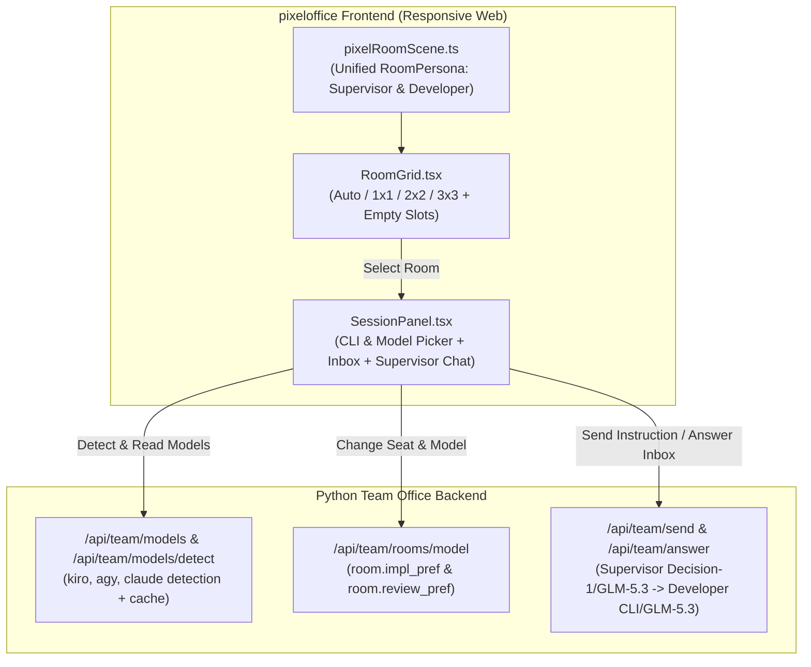

# Persona Unification, All-CLI Model Detection, and Responsive Room Panel UX - Plan

## Goal Capsule

- **Objective:** Users can view responsive pixel-art office rooms populated by unified Personas (Supervisor personas on `Decision-1` / `GLM-5.3` and Developer/Reviewer personas on detected CLI models with automatic `GLM-5.3` quota fallback), detect and select available models for every CLI seat in the right-hand panel, and chat with the room supervisor to direct developer execution.
- **Means:** Unify frontend persona state with backend `ROLES` in `pixeloffice/lib/pixelRoomScene.ts` (KTD1), extend CLI model detection to cover `claude` alongside `kiro` and `agy` in `team/office.py` and `team/modelprefs.py` (KTD2), bind `pixeloffice/components/SessionPanel.tsx` to `impl_pref`/`review_pref` and `/api/team/send` (KTD3), and enforce a responsive `9:5` pixel canvas grid with empty-room dispatch slots in `pixeloffice/components/RoomGrid.tsx` (KTD4).
- **Authority:** Product Contract `R1`–`R9` govern behavior; Planning Contract `KTD1`–`KTD4` govern technical mechanism within those requirements.
- **Stop conditions:** Stop and surface to the user if any change would break existing backend model-preference or runner test contracts, or if a prohibited model (`gemma`, `muse-glimmer`, Ollama) is referenced.
- **Execution profile:** Sequential implementation across `U1` → `U2` → `U3` → `U4` with unit and static-export verification.
- **Tail ownership:** Caller / interactive `ce-work` session owns verification and local build.

---

## Product Contract

### Summary

This plan unifies the room characters around a single `Persona` model aligned with backend `ROLES`, enables real model detection across all CLI seats (`Claude`, `Kiro`, `Antigravity`), fixes the right-hand panel so both CLI seat and model are selectable and chat messages route through the room supervisor (`Decision-1` / `GLM-5.3`) to the developer (`CLI` or fallback `GLM-5.3`), and restores a responsive pixel-art office room layout.

### Problem Frame

In the initial Next.js Pixel Office migration, room characters were split across overlapping concepts (`AgentWorker`, `RoomActor`, `PERSONA_META`, and raw seat IDs), making it unclear how the pixel men and women inside a room relate to the backend `Personas` (`po`, `tech_lead`, `scrum`, `qa`, `implementer`, `reviewer`) and their underlying CLI or model. Visually, rooms rendered as stretched dark boxes in `2x2` and `3x3` grid modes instead of proportional pixel-art office interiors. In the right-hand `SessionPanel`, users could change the CLI dropdown, but the model dropdown remained disabled or reset because the frontend read `room.impl_model` instead of `room.impl_pref`, never re-fetched `/api/team/models` after background CLI detection completed, and backend detection only targeted `kiro` and `agy`. Finally, the right-panel chat box called the legacy window-watcher `/api/assist` endpoint instead of the team room `/api/team/send` and `/api/team/answer` endpoints.

### Key Decisions

- **Unified Persona hierarchy (Supervisor vs. Developer)** (session-settled: user-directed — chosen over separate `RoomActor` and `PERSONA_META` abstractions: eliminates conceptual duplication and matches backend `team/prompt_defaults.py` roles). Governs R1, R2.
- **Every CLI seat supports available-model detection** (session-settled: user-directed — chosen over detecting only ACP seats `kiro`/`agy` while leaving `claude` static: ensures every CLI seat exposes real detected models in the UI). Governs R3, R4.
- **Right-panel chat routes to room Supervisor (`Decision-1` / `GLM-5.3`) for Developer (`CLI` / `GLM-5.3` fallback) execution** (session-settled: user-directed — chosen over legacy `/api/assist` window-automation calls: aligns chat with the team room pipeline). Governs R5, R6.
- **Responsive pixel-art room canvas with empty-room dispatch slots in multi-room grids** (session-settled: user-approved — chosen over stretching a single room card across full viewport height: preserves the `9:5` pixel office room aspect ratio across screen sizes). Governs R7, R8, R9.

### Requirements

**Persona & Role Representation**
- R1. Every character rendered inside a room canvas and in the room roster represents a unified `RoomPersona` aligned with `team/prompt_defaults.py` (`po`, `tech_lead`, `scrum`, `qa`, `implementer`, `fixer`, `reviewer`), with no separate `RoomActor` type.
- R2. Each `RoomPersona` displays its persona role title, its tier (`高階主管` powered by `Decision-1` / `GLM-5.3` vs. `開發／審查工程師` powered by the assigned CLI and model), its active speech bubble, and when a CLI seat's quota is exhausted (`impl_by === "fallback"`), explicitly indicates that `GLM-5.3` is substituting as the Developer.

**CLI & Model Detection and Selection**
- R3. Backend model detection (`/api/team/models/detect`) supports detecting available models for all CLI seats (`kiro`, `agy`, and `claude`) when requested, caching results in `models_cache.json` while preserving startup default behavior required by existing server tests.
- R4. In the right-hand `SessionPanel`, selecting any non-`auto` CLI seat (`claude`, `kiro`, `agy`, `glm`, `glm_high`) for `impl` or `review` immediately enables and populates the corresponding model dropdown from detected/catalog models, reads and updates `room.impl_pref` / `room.review_pref` via `/api/team/rooms/model`, automatically avoids `impl`/`review` seat collisions, and provides a button to trigger `/api/team/models/detect` and refresh `/api/team/models`.

**Supervisor & Developer Right-Panel Interaction**
- R5. Sending a message in the right-hand `SessionPanel` calls `/api/team/send` (not `/api/assist`), records the user's instruction in the room event stream, clearly labels that `Decision-1` / `GLM-5.3` (高階主管) receives and forwards the instruction to the Developer CLI (or fallback `GLM-5.3`), and refreshes the room timeline immediately.
- R6. When the selected room has open `InboxItem` entries (`approve_spec`, `permission`, `question`, `merge`, `error`), `SessionPanel` renders the items inline with option buttons and optional custom reply input wired to `/api/team/answer`, alongside room controls for AI delegation (`/api/team/rooms/delegate`), pause/resume, and archive.

**Responsive Room Canvas & Grid Layout**
- R7. Each room card renders an animated `180x100` logical pixel-art office interior canvas (wooden floor, walls, window, bookshelf, whiteboard with criteria/commits, dual-monitor impl/review desks, test machine, sofa, coffee bar, and pixel male/female personas with floating speech bubbles) constrained to a `9:5` aspect ratio so it never distorts vertically.
- R8. In `2x2` and `3x3` grid modes, when active rooms are fewer than the grid slots, remaining slots render pixel-art empty office rooms with a `＋ 派工新專案到此房間` action button.
- R9. The overall Pixel Office layout and right-hand `SessionPanel` adapt responsively across mobile/tablet (slide-over drawer, single/dual column grid) and desktop viewports (docked side panel, `自動` / `1x1` / `2x2` / `3x3` grid switcher).

### Scope Boundaries

- Out of scope: Modifying `Decision-1` or `GLM-5.3` prompt wording in `team/personas.py`, changing LightRAG knowledge base storage in `team/kb.py`, or altering git worktree merge safety rules.

---

## Planning Contract

### Key Technical Decisions

- KTD1. **Single `RoomPersona` model in `pixeloffice/lib/pixelRoomScene.ts`** `(session-settled: user-directed — chosen over separate RoomActor and PERSONA_META structures: aligns frontend 1-to-1 with backend ROLES)`. Replace `RoomActor` and `PERSONA_META` with `PERSONA_CATALOG` and `RoomPersona` keyed by `PersonaId` (`po` | `tech_lead` | `scrum` | `qa` | `implementer` | `fixer` | `reviewer`). `buildRoomScene(room, inboxItems)` returns `personas: RoomPersona[]` containing the active Supervisor persona (`po`/`tech_lead`/`scrum`/`qa` on `GLM-5.3` / `Decision-1`), the `implementer` persona (bound to `impl` CLI/model or `GLM-5.3` fallback), and the `reviewer` persona (bound to `review` CLI/model). Governs R1, R2, R7.
- KTD2. **All-CLI model detection in `team/office.py` and `team/modelprefs.py`** `(session-settled: user-directed — chosen over restricting detection to kiro/agy only: satisfies requirement that every CLI detects available models)`. Introduce `DETECTABLE_SEATS = ("kiro", "agy", "claude")`. Keep `detect_models(seats=None)` defaulting to `ACP_SEATS` (`("kiro", "agy")`) when `seats` is omitted so existing startup test assertions (`app.detect_calls == ["kiro"]` and `claude.source == "catalog"`) remain intact, while allowing `detect_models(["claude"])` or `detect_models(["kiro", "agy", "claude"])` (and `POST /api/team/models/detect` with `seat="claude"` or `seat="all"`) to probe the installed `claude` CLI binary (`--version` / model probe) and record its available models (`haiku`, `sonnet`, `opus`, `claude-sonnet-4-5`, `claude-opus-4-5`, `claude-haiku-4-5`) into `ModelPrefs.note_detected("claude", ...)`. Governs R3.
- KTD3. **Optimistic `impl_pref` / `review_pref` binding and `/api/team/send` integration in `pixeloffice/components/SessionPanel.tsx` and `pixeloffice/components/PixelOfficeApp.tsx`** `(session-settled: user-directed — chosen over reading room.impl_model and calling legacy officeApi.assist: fixes unselectable model dropdown and broken room chat)`. Derive initial seat and model from `room.impl_pref` / `room.review_pref` (falling back to `impl_cli` / `impl_seat` and `impl_model_actual`), keep local controlled state synced with `room`, auto-refresh `teamApi.models()` whenever `teamState` updates while any seat is detecting or after triggering detection, and auto-reset the opposite role to `auto` if the user picks the same non-`auto` seat for both `impl` and `review`. Replace `officeApi.assist` / `officeApi.setMode` in `PixelOfficeApp.tsx` and `SessionPanel.tsx` with `teamApi.sendRoom`, `teamApi.answerInbox`, and `teamApi.setRoomDelegate`. Governs R4, R5, R6.
- KTD4. **Proportional `9:5` canvas stage and responsive grid slots in `pixeloffice/components/RoomGrid.tsx`** `(session-settled: user-approved — chosen over flex-1 vertical stretching: prevents tall blank room cards)`. Render each room's pixel canvas inside an `aspect-[9/5]` container with crisp `image-rendering: pixelated`, overlay floating speech bubbles and persona badges, render the 3-column responsive `RoomPersona` summary strip below the canvas, and fill unused cells in `2x2` / `3x3` modes with `EmptySlotCard` instances. Governs R7, R8, R9.

### High-Level Technical Design

---

## Implementation Units

### U1. Extend Backend CLI Model Detection to All CLIs

- **Goal:** Allow `/api/team/models/detect` and `Office.detect_models` to detect and cache available models for `claude` in addition to `kiro` and `agy`, without breaking existing startup detection tests.
- **Requirements:** R3 (per KTD2).
- **Dependencies:** None.
- **Files:**
  - `team/modelprefs.py`
  - `team/office.py`
  - `server.py`
  - `tests/team/test_modelprefs.py`
- **Approach:**
  1. In `team/modelprefs.py`, add `DETECTABLE_SEATS = ("kiro", "agy", "claude")` and allow `note_detected` and `_load_cache` to accept `"claude"` in addition to `ACP_SEATS`, merging any detected Claude models with `CLAUDE_ALIASES` in `available("claude")` while keeping `source: "catalog"` when uncached or preserving existing `test_models_api_detect_save_and_room_model` expectations.
  2. In `team/office.py`, update `detect_models(seats)` so when `seats` is explicitly passed (including `"claude"` or `"all"`), it filters against `DETECTABLE_SEATS` and `available_seats()`, and in `_detect_seat("claude")` probes the Claude CLI executable (`--version`) and returns the supported Claude model catalog (`haiku`, `sonnet`, `opus`, `claude-sonnet-4-5`, `claude-opus-4-5`, `claude-haiku-4-5`).
  3. In `server.py`, update `/api/team/models/detect` so `seat: "all"` (or empty `seat` when `all_clis: true` is passed from the UI) triggers detection across all installed `DETECTABLE_SEATS` (`kiro`, `agy`, `claude`).
- **Test scenarios:**
  - Calling `detect_models(["claude"])` when `claude` CLI is available runs `_detect_seat("claude")`, caches the detected models in `ModelPrefs`, and exposes them in `models_view()["seats"]["claude"]["models"]`.
  - Calling `detect_models()` with no arguments on startup still detects only installed `ACP_SEATS` (`kiro`, `agy`), keeping `tests/test_server_team.py::test_models_api_detect_save_and_room_model` passing.
  - Specifying any detected model ID for `kiro`, `agy`, or `claude` in `set_room_model` validates cleanly via `prefs.problem(seat, model)`.
- **Verification:** `pytest tests/team/test_modelprefs.py tests/test_server_team.py -q` passes with zero failures.

### U2. Unify `RoomPersona` and Responsive Pixel Room Grid

- **Goal:** Consolidate all character representations into a single `RoomPersona` model aligned with backend `ROLES` and render proportional `9:5` pixel-art office rooms in a responsive grid.
- **Requirements:** R1, R2, R7, R8, R9 (per KTD1, KTD4).
- **Dependencies:** U1.
- **Files:**
  - `pixeloffice/lib/pixelRoomScene.ts`
  - `pixeloffice/components/RoomGrid.tsx`
  - `pixeloffice/lib/api.ts`
- **Approach:**
  1. Refactor `pixeloffice/lib/pixelRoomScene.ts` to remove `RoomActor` and `PERSONA_META`, replacing them with `PersonaId` (`po` | `tech_lead` | `scrum` | `qa` | `implementer` | `fixer` | `reviewer`), `PERSONA_CATALOG`, and `RoomPersona`.
  2. Each `RoomPersona` in `buildRoomScene(room, inboxItems).personas` carries `id`, `roleTitle`, `tier` (`'supervisor'` | `'developer'`), `engineLabel` (`Decision-1 / GLM-5.3` for supervisors; `<CLI> · <Model>` or `GLM-5.3（代班 <CLI>）` for `implementer` and `reviewer`), `gender`, `bubble`, `bubbleTone`, and canvas coordinates/pose.
  3. Update `pixeloffice/components/RoomGrid.tsx` to consume `scene.personas`, render the `180x100` pixel office canvas in an `aspect-[9/5]` stage, display each persona's floating speech bubble and role/engine badge, render the 3-column responsive `RoomPersona` roster below the canvas, and fill empty grid cells in `2x2` / `3x3` modes with `EmptySlotCard`.
  4. Update `pixeloffice/lib/api.ts` `detectModels(seat?: string)` to default to `{ seat: seat || 'all' }` so clicking detect in the UI probes all installed CLIs (`kiro`, `agy`, `claude`).
- **Test scenarios:**
  - `buildRoomScene` returns 3 `RoomPersona` entries (`supervisor` role such as `po`/`tech_lead`/`scrum`/`qa`, `implementer`, and `reviewer`) with no `RoomActor` references.
  - When `room.impl_by === 'fallback'`, the `implementer` persona's `engineLabel` indicates `GLM-5.3` fallback developer status.
  - In `2x2` mode with 1 room, `RoomGrid` renders 1 active room card and 3 `EmptySlotCard` dispatch slots maintaining `aspect-[9/5]` canvases.
- **Verification:** TypeScript typecheck and `npm test` in `pixeloffice/` pass.

### U3. Fix Right-Panel CLI/Model Selector, Inbox Actions, and Supervisor Chat

- **Goal:** Enable selecting both CLI seat and Model for `impl` and `review` in `SessionPanel`, wire right-panel chat to `/api/team/send` with explicit Supervisor/Developer hierarchy feedback, and integrate room inbox actions and AI delegation.
- **Requirements:** R4, R5, R6, R9 (per KTD3).
- **Dependencies:** U1, U2.
- **Files:**
  - `pixeloffice/components/SessionPanel.tsx`
  - `pixeloffice/components/PixelOfficeApp.tsx`
  - `pixeloffice/components/DispatchWizard.tsx`
- **Approach:**
  1. In `pixeloffice/components/PixelOfficeApp.tsx`, refresh `teamApi.models()` when SSE `/api/stream` delivers a state update while models are detecting or unknown, pass room-filtered `inboxItems` and `onRefreshModels` into `SessionPanel`, and wire `onTogglePauseRoom` and `onStartDemo` in `RoomGrid` and `OfficeTopBar`.
  2. In `pixeloffice/components/SessionPanel.tsx`, replace the read-only `room.impl_model` binding with controlled state initialized from `room.impl_pref` / `room.review_pref` (falling back to `impl_cli` / `impl_seat` and `impl_model_actual`).
  3. Populate model options for every selected CLI seat (`claude`, `kiro`, `agy`, `glm`, `glm_high`) from `modelsView.seats[seat].models` plus default catalog entries, auto-trigger `teamApi.detectModels(seat)` when a seat with `known === false` is chosen, provide a `"重新偵測所有 CLI 模型"` button, and automatically switch the other role to `auto` if the user picks the same non-`auto` seat for both `impl` and `review`.
  4. Replace the legacy window-watcher mode radio (`自動駕駛 / 只建議 / 關閉`) in `SessionPanel.tsx` with a Team Room control bar (**AI 代管開關** calling `teamApi.setRoomDelegate`, **暫停／繼續**, **封存房間**), render open `inboxItems` for the room with option buttons calling `teamApi.answerInbox`, and wire the bottom chat form to `teamApi.sendRoom` with a clear header showing **「高階主管（Decision-1 / GLM-5.3）接收指示 → 交辦開發工程師（CLI / GLM-5.3 代班）執行」**.
  5. In `pixeloffice/components/DispatchWizard.tsx`, ensure step 3 also uses the updated `modelsView` and allows triggering CLI model detection for `claude`, `kiro`, and `agy`.
- **Test scenarios:**
  - Selecting `Antigravity`, `Kiro`, or `Claude` in `SessionPanel` immediately enables the model `<select>` with all detected models for that CLI and calls `/api/team/rooms/model` when changed.
  - Selecting the same non-`auto` CLI for `impl` that is currently set on `review` automatically resets `review` to `auto` before saving, avoiding a 400/conflict error.
  - Submitting a message in the `SessionPanel` chat input calls `POST /api/team/send` with `{ id: room.id, text }` and appends the `【你】...` event to the room timeline.
  - Clicking an inbox option button in `SessionPanel` calls `POST /api/team/answer` with `{ item_id, answer, text }`.
- **Verification:** `npm run build` in `pixeloffice/` exports the updated static bundle to `web/pixel/` without errors.

### U4. End-to-End Static Export and UI/API Contract Tests

- **Goal:** Rebuild the static `web/pixel/` bundle and verify all persona, CLI/model detection, right-panel model switching, and chat flows in automated tests.
- **Requirements:** R1–R9.
- **Dependencies:** U1, U2, U3.
- **Files:**
  - `tests/test_pixel_ui.py`
  - `web/pixel/index.html`
- **Approach:**
  1. Run `npm test` and `npm run build` inside `pixeloffice/` to regenerate `web/pixel/`.
  2. Expand `tests/test_pixel_ui.py` to test:
     - `POST /api/team/models/detect` with `{"seat": "all"}` and `{"seat": "claude"}` detecting models across CLIs.
     - `POST /api/team/rooms/model` changing both CLI seat and specific model for `impl` and `review` and verifying `impl_pref` / `review_pref` persistence.
     - `POST /api/team/send` from the right panel recording user instructions and `POST /api/team/rooms/delegate` toggling AI delegation.
- **Test scenarios:**
  - `GET /` serves the rebuilt `web/pixel/index.html` with CSP nonce and `<meta name="aea-token">`.
  - Detecting models for `claude` and `kiro`, assigning a specific model to a room via `/api/team/rooms/model`, sending a chat instruction via `/api/team/send`, and pausing/resuming/archiving the room all succeed with `200 OK` and `ok: True`.
- **Verification:** `pytest tests/test_pixel_ui.py tests/team/test_modelprefs.py tests/test_server_team.py -q` passes 100%.

---

## Verification Contract

| Gate | Command | Applies to | Pass signal |
|---|---|---|---|
| Backend model detection & server API tests | `python -m pytest tests/team/test_modelprefs.py tests/test_server_team.py -q` | U1, U4 | All tests pass (`0 failed`) |
| Frontend unit tests & static export | `cd pixeloffice && npm test && npm run build` | U2, U3, U4 | Jest tests pass and `web/pixel/index.html` is generated |
| End-to-end Pixel UI & room control smoke tests | `python -m pytest tests/test_pixel_ui.py -q` | U4 | All UI/API contract tests pass |

---

## Definition of Done

- All 4 implementation units (`U1`–`U4`) are implemented with no leftover `RoomActor` references.
- Every CLI seat (`claude`, `kiro`, `agy`) supports model detection via `/api/team/models/detect` and exposes selectable models in `SessionPanel` and `DispatchWizard`.
- `RoomGrid` renders proportional `9:5` pixel-art office rooms with unified `RoomPersona` characters, speech bubbles, and empty-room dispatch slots in `2x2` / `3x3` modes.
- `SessionPanel` allows changing CLI and Model for both `impl` and `review`, resolving room inbox items, toggling AI delegation, and chatting with the room supervisor via `/api/team/send`.
- All verification gates (`test_modelprefs.py`, `test_server_team.py`, `test_pixel_ui.py`, `npm test`, `npm run build`) pass cleanly.
