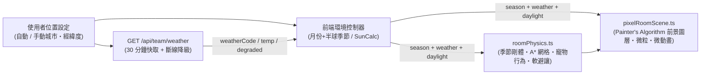
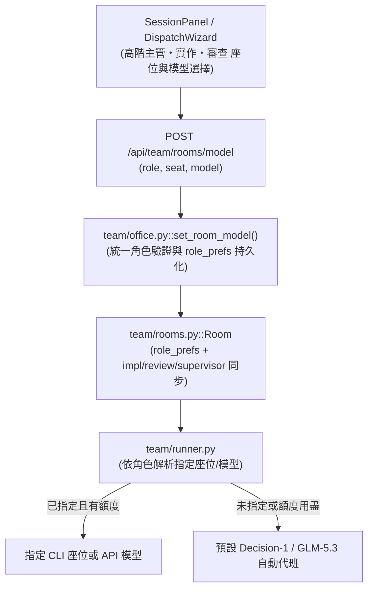

# Decision-1 四大審計升級、全職位模型指定與 LiteLLM 每日模型探索計畫

## Goal Capsule

- **Objective:** 將本會話四項 Decision-1 模型審計結論（2.5D 物理互動與家具圖層、犬貓姿態毛色與行為、真實所在地季節與即時天氣、廢棄檔案分級清理）、全職位工具與模型指定，以及 LiteLLM Proxy 每日模型／定價掃描與集中式設定檔引導精靈，整合成可分單元驗證的實作藍圖。
- **Means:** 以現有 `pixeloffice` 等距像素場景／物理引擎、Python 後端 `/api/team/*` 代理路由、`team/office.py` 房間偏好機制與 `team/bootstrap.py` + `SetupWizardModal.tsx` 設定精靈為基礎，增量擴充季節動態碰撞與 Y 軸圖層、寵物遲滯防抖與差異化互動、後端快取天氣代理與座標驅動、統一多角色 `role_prefs` 座位模型路由、集中式設定檔與 LiteLLM 每日掃描快取，以及依風險分級的死碼清理。
- **Authority Hierarchy:** 本計畫中的 `session-settled: user-directed` 決策優先於 Decision-1 審計建議；既有 `server.py` 與 `pixeloffice` 靜態匯出契約為不可破壞的整合邊界。
- **Stop Conditions:** 任一清理動作若觸及受保護的根目錄金鑰／網站筆記、造成 `pytest` 或 `pixeloffice` 測試與靜態建置失敗、或導致斷網環境下天氣查詢阻塞房間主流程，立即停止並回報。

---

## Product Contract

### Problem Frame

目前 Pixel Office 團隊協作系統在視覺真實感、情境連動、角色彈性與專案整潔度上存在五項具體缺口：

1. **2.5D 物理碰撞與圖層缺漏：** 冬天大面積格紋暖桌與夏天立式電扇尚未納入 Matter.js / A* 障礙物，雙螢幕桌與立扇缺少前景遮擋圖層，寵物會緊貼或穿過已就座人物，且就座人物靜止不動缺少工作活感。
2. **犬貓動作節奏與細節：** 寵物上下移動切換背／正面缺少遲滯防抖導致抖動，伸懶腰節奏過快且需確保原生坐／趴品種零位移鎖定；貓狗行為同質性過高，且赤柴伸懶腰格色差偏紅（RGB delta = 38.3）。
3. **自動季節與真實天氣脫節：** 自動季節尚未依真實所在地半球與即時天氣驅動窗外光影、雨雪微粒與寵物作息，也缺少可離線降級的後端天氣快取與手動城市／經緯度設定。
4. **職位工具與模型指定受限：** 目前僅「實作工程師（`impl`）」與「獨立審查員（`review`）」可選 CLI 座位與指定模型，高階主管／Scrum（`supervisor`，涵蓋 PO／Tech Lead／Scrum／QA）在介面與後端皆被寫死為 `Decision-1 / GLM-5.3`，無法依需求指定工具與模型。
5. **廢棄檔案堆積：** 根目錄與 `pixeloffice/` 殘留測試遺留檔、未被引用的 React 元件、廢棄舊版 PNG 與舊版 Tkinter 自動點擊器程式碼，增加維護雜訊。
6. **模型清單與連線設定分散：** 目前缺少向 LiteLLM Proxy（預設 `http://172.22.119.193:4000`）自動掃描 `/v1/models` 與 `/model_group/info` 並換算 `USD / 1,000,000 tokens` 定價的每日機制；且各類連線金鑰與端點仍部分仰賴手動編輯零散檔案，缺少單一集中式設定檔與完整引導精靈讓使用者一次填入所有必要連線資訊。

### Actors

- **A1. 團隊操作者（開發者）：** 在 Pixel Office 網頁介面管理房間、切換季節與城市位置、為各職位指派 CLI 工具與模型。
- **A2. 室內角色（人類主管／實作／審查員與陪伴犬貓）：** 在等距房間內進行物理移動、就座工作、伸懶腰與季節／天氣反應。
- **A3. 企業內網／離線環境後端（`server.py` + `team/`）：** 提供模型路由、多角色座位分派與可容錯降級的天氣代理 API。

### Requirements

- **R1. 季節動態障礙物與家具前景圖層：** 冬天暖桌（`P=0.993`）與夏天立式電扇（`P=0.924`）須隨季節動態更新 Matter.js 剛體與 A* 尋路網格；雙螢幕桌（`P=0.958`）、夏天立扇與春秋地爐邊框（`P=0.651`）納入 Painter's Algorithm Y 軸前景遮擋。
- **R2. 人物就座保護與工作微動畫：** 寵物移動時對已就座人類施加軟避讓斥力（`P=0.967`）；已就座人類依工作狀態呈現細微鍵盤／螢幕／呼吸微動畫（`P=0.980`），且維持座標錨定不漂移。
- **R3. 犬貓姿態穩定度與毛色一致性：** 寵物正面／背面切換須具備速度遲滯防抖（`vy < -0.16` 切背面、`vy > -0.05` 切正面，`P=0.991`）；伸懶腰具備起身過渡與 2.2–3.2 秒停留節奏（`P=0.992`）；原生坐／趴品種保持零位移鎖定（`P=0.997`）；維持整圖不斷裂原則（`P=0.731`）；修正赤柴（`dogs[1]`）伸懶腰色調使其與站姿暖橘茶色一致。
- **R4. 犬貓差異化與氣候行為：** 區分狗（熱情搖尾追球迎人）與貓（保持距離偶爾蹭人）互動（`P=0.971`）；依季節溫度偏好導引休息點（冬天靠暖桌／地爐、夏天靠電扇／木地板，`P=0.798`）；雨天／雪天／夜晚偏向室內打盹並放慢步速（`P=0.986`）。
- **R5. 真實所在地季節推算與快取天氣代理：** 自動季節依電腦真實月份與南北半球離線推算（`P=0.991`）；新增後端代理端點 `GET /api/team/weather` 查詢免金鑰即時天氣並快取 30 分鐘（`P=0.984`）；內網斷線或防火牆阻擋時優雅降級且絕不阻塞或報錯（`P=0.998`）。
- **R6. 手動位置設定與場景環境連動：** 允許操作者手動指定城市或經緯度（`P=0.996`），同步驅動 `SunCalc` 日照時間、窗外陰雨／降雪光影微粒與寵物作息（`P=0.977`）。
- **R7. 全職位工具與模型指定：** 解除僅限 `impl` / `review` 的限制，讓房間內所有主要職位（至少涵蓋高階主管／Scrum `supervisor`、實作工程師 `impl`、獨立審查員 `review`，並支援後端 `po` / `tech_lead` / `scrum` / `qa` 細分覆寫）皆可指定工具／CLI 座位與模型；未指定時保留原本自動／`Decision-1 / GLM-5.3` 預設與額度耗盡代班行為。
- **R8. 廢棄檔案安全分級清理：** 清除確認無引用之遺留雜檔、廢棄 React 元件、廢棄舊 PNG（含 `AssetKey` 清理）與舊版 Tkinter 自動點擊器檔案與對應舊測試，**嚴格保留 `中鋼主權AI_KEY.md` 與 `中鋼主權AI網站.md` 於專案根目錄原位**。
- **R9. 集中式本機設定檔與連線引導精靈：** 將系統所有外部連線端點與金鑰收斂為單一 `.gitignore` 受保護設定檔（`litellm.local.json`，附完整範例範本 `litellm.local.example.json`），透過升級版前端引導精靈（`SetupWizardModal.tsx`）引導使用者填入所有必要資訊（LiteLLM Proxy URL 與 API Key、Decision-1 Key、預設模型、中鋼主權 AI URL／Key／Embedding／Rerank、Wiki API 選填連線等），預設帶入目前 Y6P2 設定（如 `http://172.22.119.193:4000`）作為初值，且所有金鑰回傳前端均採遮罩呈現。
- **R10. LiteLLM Proxy 線上模型與定價每日自動掃描：** 以目前設定作為預設種子清單，每日自動呼叫設定的 LiteLLM Proxy `/v1/models` 與 `/model_group/info`（並支援手動立即重新掃描），將 API 回傳的 `input_cost_per_token` 與 `output_cost_per_token` 分別乘以 `1,000,000` 換算為 `USD / 1,000,000 tokens`，快取持久化至本機並同步供全職位模型選單（R7）與用量費用估算使用；代理離線或金鑰未設時優雅保留預設與上次快取。

### Key Product Decisions

- **PD1. 保留根目錄金鑰與網站筆記（session-settled: user-directed — chosen over 移出或刪除 Tier 4 全數檔案: 使用者明確指示 `中鋼主權AI_KEY.md` 與 `中鋼主權AI網站.md` 不可移除須繼續保留）。** Governs R8.
- **PD2. 全職位皆開放指定工具與模型（session-settled: user-directed — chosen over 維持主管職位寫死 Decision-1 / GLM-5.3: 使用者要求所有職位皆應可指定模型與工具）。** Governs R7.
- **PD3. 排除寵物眼神／朝向鎖定互動人物或球（Decision-1 `P=0.018` 明確否決）。** 避免過度複雜化像素精靈朝向狀態機。
- **PD4. 集中式設定檔搭配引導精靈收集所有連線金鑰（session-settled: user-directed — chosen over 繼續手動編輯零散檔案填入 key: 使用者要求統一收斂為 config 檔並提供引導讓使用者填入所有必要連線資訊）。** Governs R9.
- **PD5. LiteLLM Proxy 每日掃描線上模型與 USD/1M 定價並以現行設定為預設（session-settled: user-directed — chosen over 靜態寫死模型與價格清單: 確保線上新增模型與最新 token 價格自動同步，同時維持離線與既有預設相容）。** Governs R10.

### Scope Boundaries

#### In Scope
- `pixeloffice/lib/roomPhysics.ts`、`pixeloffice/lib/pixelRoomScene.ts` 與相關精靈資產（赤柴伸懶腰色調微調）。
- 後端 `server.py`、`team/weather.py`（新模組）、`team/model_catalog.py`（新模組）、`team/bootstrap.py`、`team/models.py`、`team/rooms.py`、`team/office.py`、`team/runner.py`、`team/modelprefs.py`、`team/usage.py`。
- 前端 `pixeloffice/components/SessionPanel.tsx`、`pixeloffice/components/DispatchWizard.tsx`、`pixeloffice/components/SetupWizardModal.tsx`、`pixeloffice/components/PixelOfficeApp.tsx`、`pixeloffice/lib/api.ts`。
- 專案根目錄範例設定檔 `litellm.local.example.json`（不含任何真實金鑰）。
- Tier 1、Tier 2a、Tier 2b、Tier 3 廢棄檔案清理與對應測試同步。

#### Explicitly Out of Scope
- 寵物朝向與凝視鎖定互動人類或玩具球（Decision-1 `P=0.018`）。
- 移除或搬動 `中鋼主權AI_KEY.md` 與 `中鋼主權AI網站.md`（PD1 禁止）。
- 重寫既有的多 CLI 額度偵測機制或變更 `web/pixel` 靜態匯出部署架構。

#### Deferred to Follow-Up Work
- 將其餘非執行期參考文件（`Y6P2_Decision-1.md`、`Y6P2_Wiki_API.md`、`Y6P2_liteLLMAPI.md`）整理至 `docs/reference/` 並同步更新 `tests/test_projects.py`（留待後續單獨文件整理 PR，避免與本次功能與清理範圍混淆）。

### Success Criteria

- 切換春／夏／秋／冬四季節時，人物與寵物絕不穿過冬天暖桌、夏天立扇或雙螢幕桌，且前後排圖層遮擋正確。
- 寵物移動不再於背／正面之間閃爍，伸懶腰與原生坐／趴品種無滑行破圖，赤柴各姿態色差降至視覺一致。
- 斷網環境下開啟頁面與查詢 `/api/team/weather` 均於逾時門檻內平順回傳降級結果，手動輸入城市或經緯度可即時更新季節、日照與天氣表現。
- 房間建立精靈與面板內，高階主管／Scrum、實作工程師、獨立審查員皆可獨立指定工具座位與模型，名牌與實際呼叫路徑一致。
- 使用者可透過設定引導精靈一次填妥 LiteLLM Proxy、Decision-1、中鋼主權 AI 等所有連線與金鑰至統一設定檔（不暴露明文金鑰）；系統每日自動掃描 `/v1/models` 與 `/model_group/info` 並正確換算 `USD / 1,000,000 tokens` 定價，離線時保留預設與上次快取。
- 清理後 Python `pytest`、前端 `npm test` 與 `npm run build` 靜態匯出全數通過，且 `中鋼主權AI_KEY.md` 與 `中鋼主權AI網站.md` 完好保留。

---

## Planning Contract

### Key Technical Decisions

- **KTD1. 季節碰撞體與尋路網格採按季節快取重建（Governs R1）：** 在 `pixeloffice/lib/roomPhysics.ts` 以 `getObstaclesForSeason(season)` 取代單一靜態 `ROOM_OBSTACLES`，為每個季節懶加載快取獨立 `PF.Grid` 與 Matter.js 靜態剛體集合；切換季節時僅替換差異剛體，避免每幀重建影響效能。
- **KTD2. 統一前景遮擋圖層表（Governs R1, R2）：** 在 `pixeloffice/lib/pixelRoomScene.ts` 以資料驅動的 `FOREGROUND_LAYERS` 描述各季節中央家具（冬暖桌、夏茶几、春秋地爐邊框）、夏天立扇與雙螢幕桌的裁切框與基準 `y` 值，共用既有 Painter's Algorithm 深度排序，不重複寫入多組條件分支。
- **KTD3. 寵物狀態機遲滯門檻與品種行為特徵表（Governs R3, R4）：** 在 `pixeloffice/lib/roomPhysics.ts` 為每隻寵物保留 `facingBack: boolean` 狀態並套用遲滯雙門檻（`vy < -0.16` 轉背面、`vy > -0.05` 轉正面）；伸懶腰改為 `rising -> stretching (2.2–3.2s) -> settling` 三階段計時；透過 `species` 與 `staticPose` 屬性統一驅動狗／貓互動半徑、季節吸引點與天氣步速係數。
- **KTD4. 後端免金鑰天氣代理與 30 分鐘記憶體快取（Governs R5, R6）：** 新增 `team/weather.py` 封裝 Open-Meteo 查詢與選配 IP 地理定位，透過既有系統憑證設定（如 `team/netcerts.py` 或標準 HTTPS 逾時設定，單次請求逾時 ≤ 4 秒）抓取天氣，並依量化後經緯度快取 30 分鐘；失敗時回傳結構化降級旗標（`degraded: true`）並保留最近快取或離線預設，絕不拋出 500。
- **KTD5. 房間多職位統一偏好欄位 `role_prefs` 與向後相容同步（Governs R7, PD2 — session-settled: user-directed — chosen over 僅新增單一 `supervisor_cli` 硬編碼欄位: 支援高階主管與各細分角色一致擴充，同時維持舊房間 JSON 零遷移成本）：** 在 `team/rooms.py` 保留既有 `impl_cli`/`impl_pref`、`review_cli`/`review_pref`，新增 `supervisor_cli`/`supervisor_pref` 與通用 `role_prefs: Dict[str, Dict[str, str]]`（支援 `supervisor`、`impl`、`review` 及可選細分 `po`/`tech_lead`/`scrum`/`qa`）；`set_room_model()` 驗證與讀寫採統一角色映射表，不重複 `if/elif` 分支；執行期 `team/runner.py` 優先讀取該角色指定偏好，未指定或額度不足時無縫回退既有的 `Decision-1 / GLM-5.3`。
- **KTD6. 分級清理順序與保留保護清單（Governs R8, PD1 — session-settled: user-directed — chosen over 一次性刪除所有根目錄非執行期檔: 保護使用者指定的金鑰與網站檔案，並確保每次刪除前已移除所有引用）：** 清理僅涵蓋 Tier 1（`claude_was_here.txt`）、Tier 2a（未用 React 元件）、Tier 2b（5 張舊 PNG 並先移除 `AssetKey` 宣告）、Tier 3（7 支舊 Tkinter Python 檔與 5 支對應舊測試）；明確將 `中鋼主權AI_KEY.md`、`中鋼主權AI網站.md` 與 `Y6P2_*.md` 列入保護名單不予觸動。
- **KTD7. 統一本機設定檔 Schema 與引導精靈（Governs R9, PD4 — session-settled: user-directed — chosen over 新增第二個互斥設定檔: 直接擴充既有 `litellm.local.json` 為單一權威本機設定檔，零破壞相容既有用戶，並提供 `litellm.local.example.json` 範本與 `.gitignore` 保護）：** 擴充 `team/bootstrap.py::save_model_config()` 與 `SetupWizardModal.tsx`，涵蓋 LiteLLM Proxy（預設 `http://172.22.119.193:4000`）、主 API Key、Decision-1 Key、預設模型、中鋼主權 AI（`sovereign_base_url`、`sovereign_key`、`embedding_model`、`embedding_dim`、`rerank_model`）與選填 Wiki API 連線欄位；欄位留空時保留既有已存金鑰，回傳前端一律只給遮罩預覽（`***`），安全匯出快照（`export_safe_profile`）仍嚴格排除所有金鑰。
- **KTD8. LiteLLM 模型與定價每日自動掃描快取（Governs R10, PD5 — session-settled: user-directed — chosen over 每次請求即時打 Proxy 或人工維護清單: 每日自動掃描一次並落地快取，兼顧清單即時性與離線穩定度）：** 新增 `team/model_catalog.py`，合併 `/v1/models` 與 `/model_group/info` 回應，依 `input_cost_per_token * 1_000_000`、`output_cost_per_token * 1_000_000` 換算為 `USD / 1,000,000 tokens`（缺值保留 `null` 不誤填 `0`），持久化於 `sessions/team/litellm_catalog.json`；啟動時若距 `last_scanned_at` 超過 24 小時則非阻塞背景掃描，並由每日排程執行緒固定每 24 小時重掃一次，失敗時無縫保留既有預設與上次成功快取。

### High-Level Technical Design

#### 1. 季節物理、天氣代理與場景渲染資料流

#### 2. 全職位工具與模型指定路由流程

#### 3. 集中式設定檔與 LiteLLM 每日模型／定價掃描資料流

```mermaid
flowchart LR
  Wizard["SetupWizardModal.tsx\n(集中式連線與金鑰引導精靈)"] -->|"POST /api/team/preflight/save"| Bootstrap["team/bootstrap.py\n(原子寫入 litellm.local.json + 遮罩回傳)"]
  Bootstrap --> Config["litellm.local.json\n(預設 http://172.22.119.193:4000)"]
  Config --> Scanner["team/model_catalog.py\n(啟動檢查 + 每日 24h 排程 / 手動觸發)"]
  Scanner -->|"GET /v1/models & /model_group/info"| Proxy["LiteLLM Proxy"]
  Proxy -->|"input/output_cost_per_token × 1e6"| Catalog["sessions/team/litellm_catalog.json\n(模型清單 + USD/1M 定價 + 預設降級)"]
  Catalog --> RoleUI["全職位模型選單 (U7/U8)\n與用量費用估算 (team/usage.py)"]
```

### Sequencing & Phased Delivery

1. **Phase 1 — 2.5D 物理與犬貓行為（U1 → U2 → U3 → U4）：** 先完成季節碰撞體與圖層遮擋，再疊加寵物防抖、伸懶腰節奏、毛色校正與差異化／氣候行為。
2. **Phase 2 — 真實季節與即時天氣連動（U5 → U6）：** 先實作後端快取代理與降級契約，再接上前端位置設定、離線半球季節推算、SunCalc 與窗外光影微粒。
3. **Phase 3 — 集中式設定檔、LiteLLM 每日掃描與全職位模型指定（U10 → U11 → U7 → U8）：** 先建立集中式設定檔引導與每日模型／定價掃描快取，再擴充全職位後端路由與前端選單直接消費最新線上模型清單與 USD/1M 定價。
4. **Phase 4 — 廢棄檔案安全清理（U9）：** 在所有功能測試穩定後執行分級清理，確保零誤刪與零斷鏈。

### System-Wide Impact & Risk Mitigation

- **企業內網 TLS 與離線風險（R5）：** 若 Open-Meteo 或 IP 定位被代理／防火牆攔截，後端必須在短逾時內回傳 `degraded: true` 並由前端以離線月份＋半球推算季節，避免拖慢頁面載入。
- **既有房間持久化相容性（R7）：** 舊版 `rooms.json` 不含 `supervisor_cli` / `role_prefs` 欄位；`Room` 反序列化必須對缺漏欄位給定安全預設空值，且實作／審查不可選同一 CLI 座位的既有規則維持有效（高階主管預設允許與 CLI 獨立或選用 API 模型，若選用同一 CLI 座位需明確決定是否允許共享或提示衝突）。
- **像素資產與測試回歸（R1, R3, R8）：** 移除 5 張舊 PNG 前必須確認 `pixeloffice/lib/` 與 `pixeloffice/components/` 無任何殘留 `AssetKey` 引用；清理 Tier 3 舊測試後確認剩餘測試套件仍覆蓋所有現行 `server.py` 與 `team/` 路徑。

### Deferred Implementation Notes

- 冬天暖桌、夏天立扇與雙螢幕桌前景圖層的精準像素裁切座標（`x, y, w, h, sortY`）將於實作 U1/U2 時直接對照 `pixeloffice/public/pixel-assets/` 四季房間圖實測微調。
- 高階主管（`supervisor`）若選用外部 CLI 座位（如 Kiro / Claude CLI）執行 PO／Scrum 短回覆時的提示詞包裝與逾時上限，將於 U7 實作階段依 `team/runner.py` 既有 `_open` 與 `ModelRouter` 介面細節定案。

---

## Implementation Units

### U1. 季節動態障礙物與人物軟避讓物理引擎

- **Goal:** 讓 `pixeloffice/lib/roomPhysics.ts` 依當前季節動態切換障礙物碰撞體與 A* 尋路網格（支援冬天暖桌、夏天立式電扇與春秋地爐），並加入寵物對已就座人類的軟避讓斥力。
- **Requirements:** R1, R2
- **Dependencies:** 無
- **Files:**
  - Modify: `pixeloffice/lib/roomPhysics.ts`
  - Test: `pixeloffice/lib/office-sim.test.ts`
- **Approach:**
  1. 依 KTD1 將靜態 `ROOM_OBSTACLES` 重構為 `getObstaclesForSeason(season)`，保留共通障礙物並按季節加入冬天暖桌（約 `x: 112..158, y: 76..101`）、夏天立式電扇（約 `x: 172..186, y: 64..86`）與春秋地爐。
  2. 為各季節快取對應的 `PF.Grid` 與 Matter.js 靜態障礙剛體，提供季節切換同步介面，確保切換季節時不殘留舊季節剛體。
  3. 在寵物力場更新迴圈中，對所有處於就座鎖定狀態的人類座標施加平滑距離衰減的軟避讓斥力，避免寵物貼臉或重疊於座墊上。
- **Patterns to follow:** 沿用 `pixeloffice/lib/roomPhysics.ts` 既有的 `ROOM_OBSTACLES`、`cachedBaseGrid` 與 Matter.js 靜態剛體建立模式。
- **Test scenarios:**
  - Happy path: 冬天模式下請求穿過暖桌中心（`135, 88`）的 A* 路徑，驗證路徑繞開暖桌矩形且所有路徑點不在障礙區內。
  - Happy path: 夏天模式下驗證立式電扇區域被標記為不可通行，而冬天暖桌外緣座墊區域恢復可通行。
  - Edge case: 連續在春→夏→秋→冬間切換季節，驗證 Matter.js 世界中障礙剛體數量與當前季節定義一致，無重複堆疊。
  - Integration: 寵物朝向已就座人類位置移動多步，驗證軟避讓斥力使寵物維持最小安全距離且不推離已鎖定的人類座標。
- **Verification:** 物理單元測試覆蓋四季障礙物切換與軟避讓不變量並全數通過。

### U2. 等距家具前景圖層與就座人類微動畫

- **Goal:** 在 `pixeloffice/lib/pixelRoomScene.ts` 以統一資料表補齊雙螢幕桌、夏天立式電扇與春秋地爐邊框的前景 Y 軸遮擋圖層，並為已就座人類加入工作微動畫。
- **Requirements:** R1, R2
- **Dependencies:** U1
- **Files:**
  - Modify: `pixeloffice/lib/pixelRoomScene.ts`
  - Test: `pixeloffice/lib/office-sim.test.ts`
- **Approach:**
  1. 依 KTD2 建立資料驅動的季節家具前景層清單，統一涵蓋冬天暖桌、夏天茶几與立扇、春秋地爐邊框，以及雙螢幕工作桌前景裁切層，直接併入既有 Painter's Algorithm 深度排序陣列。
  2. 為就座中人類新增細微週期性工作微動畫（工作狀態打字／閱讀微幅擺動與螢幕反光呼吸，休息狀態緩和節奏），全程鎖定腳部／座墊錨點避免位移漂移。
  3. 嚴格維持 PD3，不加入寵物凝視鎖定人物／球之額外朝向狀態。
- **Patterns to follow:** 沿用 `pixeloffice/lib/pixelRoomScene.ts` 中 `drawRoomCanvas` 既有的冬天暖桌／夏天茶几前景裁切與 `sortY` 排序機制。
- **Test scenarios:**
  - Happy path: 給定各季節與人物位於家具後方／前方兩組 `y` 座標，驗證前景圖層排序列表將後方人物排在家具前繪製、前方人物排在家具後繪製。
  - Happy path: 就座人類處於 `working` 與 `idle` 狀態時，微動畫偏移函式回傳有界微幅變化且基底座墊錨點座標不變。
  - Edge case: 切換至無立扇季節（冬／春／秋）時，前景層清單不包含夏天立扇圖層。
- **Verification:** 場景排序與微動畫輔助函式通過測試，靜態建置與畫面檢查無穿模破圖。

### U3. 犬貓遲滯防抖、伸懶腰節奏與赤柴色調校正

- **Goal:** 消除犬貓背／正面視角切換抖動，建立自然的伸懶腰起身過渡與 2.2–3.2 秒停留節奏，鎖定原生坐／趴品種零位移，並校正赤柴伸懶腰格色調。
- **Requirements:** R3
- **Dependencies:** U1
- **Files:**
  - Modify: `pixeloffice/lib/roomPhysics.ts`
  - Modify: `pixeloffice/lib/pixelRoomScene.ts`
  - Modify: `pixeloffice/public/pixel-assets/roster-dogs-stretch-12.png`
  - Test: `pixeloffice/lib/office-sim.test.ts`
- **Approach:**
  1. 依 KTD3 在寵物步態狀態加入 `facingBack` 遲滯判斷：僅當 `vy < -0.16` 切換為背面、`vy > -0.05` 切回正面，介於兩者之間保持原視角。
  2. 將寵物伸懶腰拆為起身過渡、2.2–3.2 秒停留伸展與恢復三段節奏，並維持整圖繪製不裁切尾巴或耳朵。
  3. 強化原生坐姿／趴姿品種零位移鎖定檢查，允許原地伸懶腰但禁止任何滑行位移。
  4. 調整 `roster-dogs-stretch-12.png` 中 `dogs[1]`（赤柴）格之暖橘茶色色階，使其與站姿／休息姿態色差收斂。
- **Patterns to follow:** 沿用 `pixeloffice/lib/pixelRoomScene.ts` 既有的 `dogsBack` / `catsBack` 精靈切換與寵物伸展計時結構。
- **Test scenarios:**
  - Happy path: 寵物 `vy` 依序變化 `-0.08 -> -0.18 -> -0.10 -> -0.02`，驗證 `facingBack` 依序為 `false -> true -> true -> false`（不因微幅波動翻轉）。
  - Happy path: 觸發伸懶腰時驗證停留區間落在 `2.2s ~ 3.2s` 且經過起身過渡狀態。
  - Edge case: 原生坐／趴品種在多幀更新與伸懶腰期間，驗證其 `(x, y)` 座標位移始終為 `0`。
- **Verification:** 寵物視角防抖、伸懶腰節奏與零位移鎖定測試通過，赤柴伸懶腰精靈與站姿 RGB 差異顯著收斂且無破圖。

### U4. 貓狗差異化互動與季節／天氣作息行為

- **Goal:** 讓狗與貓呈現鮮明性格差異（狗熱情追球迎人、貓高冷保持距離偶爾蹭人），並依季節溫度偏好與雨／雪／夜晚天氣調整休息位置與步速。
- **Requirements:** R4
- **Dependencies:** U1, U3
- **Files:**
  - Modify: `pixeloffice/lib/roomPhysics.ts`
  - Modify: `pixeloffice/lib/pixelRoomScene.ts`
  - Test: `pixeloffice/lib/office-sim.test.ts`
- **Approach:**
  1. 依 `species` 建立行為參數表：狗具備較短親近距離、主動追球與接近返座人類；貓具備較大個人空間半徑、低機率短暫蹭近後自行回到高處／角落休息。
  2. 依當前季節注入溫度偏好吸引點：冬天偏好暖桌／地爐周邊安全區，夏天偏好立式電扇與涼木地板區。
  3. 接收環境天氣（雨／雪）與時段（夜晚）訊號：當處於雨、雪或夜晚時提高打盹機率並套用步速衰減係數。
- **Patterns to follow:** 沿用 `pixeloffice/lib/roomPhysics.ts` 既有的寵物目標點選擇與 `QuadrupedGaitState` 速度控制。
- **Test scenarios:**
  - Happy path: 同等初始條件下，狗對玩家／球產生主動靠近意圖，貓維持較大預設距離。
  - Happy path: 冬天偏好選點落在暖桌／地爐周邊，夏天偏好選點落在電扇／木地板區，且目標點皆避開 U1 季節障礙物。
  - Edge case: 切換為雨天、雪天或夜晚時，驗證寵物步速係數低於晴朗白天且打盹權重提高。
- **Verification:** 行為參數與季節／天氣意圖測試通過，且寵物目標點永不落入障礙物內。

### U5. 後端免金鑰天氣代理與 30 分鐘快取降級 API

- **Goal:** 新增後端天氣代理模組與 `GET /api/team/weather` 端點，支援經緯度或 IP 自動定位查詢 Open-Meteo、30 分鐘快取與企業內網斷線優雅降級。
- **Requirements:** R5, R6
- **Dependencies:** 無
- **Files:**
  - Create: `team/weather.py`
  - Modify: `server.py`
  - Create: `tests/team/test_weather.py`
- **Approach:**
  1. 依 KTD4 在 `team/weather.py` 實作 `WeatherService`：接受選填 `lat`、`lon`、`city` 查詢參數；未提供座標時以短逾時嘗試免金鑰地理定位，提供 `city` 時透過 Open-Meteo Geocoding 解析座標。
  2. 以量化座標作為快取鍵實作 30 分鐘記憶體 TTL 快取，回傳標準化天氣分類（`clear` / `cloudy` / `rain` / `snow`）、氣溫、座標、城市標籤、半球（`north` / `south`）、快取時間戳與 `degraded` 旗標。
  3. 網路失敗、DNS 錯誤、TLS 憑證錯誤或逾時皆捕捉並回傳 `200 OK` 搭配 `degraded: true` 與安全預設欄位（若有過期快取可附帶標記），確保前端絕不因內網防火牆掛起或噴錯。
  4. 在 `server.py` 註冊 `GET /api/team/weather` 路由並對無效經緯度回傳明確 `400` 驗證訊息。
- **Execution note:** Implement `team/weather.py` and `/api/team/weather` with mocked HTTP responses first to prove cache TTL and offline fallback behavior without live network dependency.
- **Patterns to follow:** 沿用 `server.py` 既有 `/api/team/*` JSON 路由慣例與 `team/netcerts.py` 系統憑證處理模式。
- **Test scenarios:**
  - Happy path: 傳入有效 `lat`/`lon` 呼叫 `GET /api/team/weather`，驗證回傳標準化天氣分類、溫度、半球與 `degraded: false`。
  - Happy path: 30 分鐘 TTL 內重複查詢相同位置，驗證命中記憶體快取且僅觸發一次底層 HTTP 請求。
  - Edge case: 傳入 `city` 名稱時完成地理編碼並回傳對應座標與天氣；傳入南半球負緯度時回傳 `hemisphere: "south"`。
  - Error path: 模擬上游逾時、連線拒絕或非 200 回應時，驗證端點仍回傳 `200` 搭配 `degraded: true` 且不拋出未捕捉例外。
  - Error path: 傳入超出範圍的緯度（如 `lat=999`）時回傳 `400` 錯誤訊息。
- **Verification:** `tests/team/test_weather.py` 全數通過且不依賴外部真實網路。

### U6. 前端真實所在地季節推算、手動位置設定與天氣視覺連動

- **Goal:** 讓前端自動季節依電腦真實月份與南北半球離線推算，接入 `/api/team/weather` 與手動城市／經緯度設定，同步驅動 `SunCalc` 日照與窗外雨雪／陰晴光影及寵物作息。
- **Requirements:** R5, R6
- **Dependencies:** U4, U5
- **Files:**
  - Modify: `pixeloffice/lib/api.ts`
  - Modify: `pixeloffice/lib/pixelRoomScene.ts`
  - Modify: `pixeloffice/components/PixelOfficeApp.tsx`
  - Test: `pixeloffice/lib/office-sim.test.ts`
- **Approach:**
  1. 新增離線季節推算純函式：依據本機日期月份與半球（北半球 3–5 春、6–8 夏、9–11 秋、12–2 冬；南半球反轉）即時決定自動季節，零網路延遲。
  2. 在 `pixeloffice/lib/api.ts` 加入 `getWeather(params)` 呼叫 `GET /api/team/weather`，並在 `PixelOfficeApp.tsx` 狀態層提供「自動定位／手動指定城市或經緯度」設定並持久化於 `localStorage`。
  3. 將解析後的 `lat`/`lon` 同步傳入 `SunCalc` 計算真實日出日落光影，並把即時天氣分類（晴／陰／雨／雪）傳遞至 `pixelRoomScene.ts` 窗外微粒與 `roomPhysics.ts` 寵物作息參數。
  4. 當後端回傳 `degraded: true` 或請求異常時，介面低調顯示離線狀態提示並無縫維持離線季節與預設光影。
- **Patterns to follow:** 沿用 `pixeloffice/lib/api.ts` 既有 `getJson` 封裝與 `PixelOfficeApp.tsx` 的季節／主題狀態管理。
- **Test scenarios:**
  - Happy path: 驗證北半球與南半球在 1 月、4 月、7 月、10 月皆推算出正確季節。
  - Happy path: 手動設定城市座標後，驗證 `SunCalc` 採用新經緯度且雨／雪天氣正確傳入室內環境狀態。
  - Error path: 模擬 `/api/team/weather` 回傳 `degraded: true` 或網路失敗，驗證頁面不崩潰且自動季節仍正確顯示。
- **Verification:** 前端季節／天氣單元測試通過，手動切換城市與斷網降級行為驗證無誤。

### U7. 後端全職位工具與模型偏好模型及執行路由

- **Goal:** 擴充後端房間資料模型、`set_room_model()` API 與 `team/runner.py` 執行路由，讓高階主管／Scrum（`supervisor` 及細分角色）與實作／審查員皆可獨立指定工具座位與模型。
- **Requirements:** R7
- **Dependencies:** 無
- **Files:**
  - Modify: `team/rooms.py`
  - Modify: `team/office.py`
  - Modify: `team/runner.py`
  - Modify: `team/modelprefs.py`
  - Modify: `server.py`
  - Modify: `tests/test_server_team.py`
- **Approach:**
  1. 依 KTD5 在 `team/rooms.py` 新增 `supervisor_cli`、`supervisor_seat`、`supervisor_model`、`supervisor_model_actual`、`supervisor_pref` 與統一 `role_prefs` 字典，反序列化時與既有 `impl_pref`／`review_pref` 雙向對齊，確保舊房間資料零痛點載入。
  2. 擴充 `team/office.py::set_room_model()` 接受 `role` 為 `supervisor`、`impl`、`review`（以及細分 `po`、`tech_lead`、`scrum`、`qa`），以統一角色映射表完成座位／模型合法性驗證與持久化；保留 `impl` 與 `review` 須不同座位原則，並對 `supervisor` 支援選用 `auto`（預設 Decision-1 / GLM-5.3）、任一可用 CLI 座位或 LiteLLM 模型。
  3. 同步更新建立房間與接續開新房（handoff）流程，正確承接 `supervisor` 與 `role_prefs` 設定。
  4. 更新 `team/runner.py` 讓高階主管職位呼叫先解析 `role_prefs`／`supervisor_pref`：若已指定 CLI 座位或模型則走對應驅動／模型路由，未指定或額度耗盡時自動回退既有 `Decision-1 / GLM-5.3`。
- **Patterns to follow:** 沿用 `team/office.py::set_room_model()` 與 `team/runner.py` 既有 `impl_pref` / `review_pref` 解析與 `_impl_pref_key` 熱切換模式。
- **Test scenarios:**
  - Happy path: 呼叫 `POST /api/team/rooms/model` 設定 `role="supervisor"` 為指定座位與模型，驗證房間持久化 `supervisor_cli`、`supervisor_pref` 與 `role_prefs["supervisor"]` 並反映於 `/api/team/state`。
  - Happy path: 建立新房間與接續開新房時指定三個職位的座位與模型，驗證皆完整保存且 `impl`／`review` 互異驗證仍生效。
  - Edge case: 載入不含 `supervisor_pref` / `role_prefs` 的舊版 `Room` 字典，驗證預設回退為 `auto`（Decision-1 / GLM-5.3）不報錯。
  - Error path: 傳入不認得的 `role` 名稱、無效座位或在 `demo`／`archived` 房間變更主管模型時，回傳明確中文 `400` 錯誤。
  - Integration: `team/runner.py` 執行主管角色步驟時，驗證有指定模型走指定路由、額度不足或清空偏好後回退預設模型。
- **Verification:** `tests/test_server_team.py` 與 `tests/team/test_bootstrap_and_budget.py` 新增與既有測試全數通過。

### U8. 前端全職位工具與模型切換介面及名牌同步

- **Goal:** 更新房間側邊欄「CLI 座位與模型切換」、開房精靈與角色名牌，讓高階主管／Scrum、實作工程師、獨立審查員皆可直覺選用工具與模型並即時顯示實際配置。
- **Requirements:** R7
- **Dependencies:** U7
- **Files:**
  - Modify: `pixeloffice/components/SessionPanel.tsx`
  - Modify: `pixeloffice/components/DispatchWizard.tsx`
  - Modify: `pixeloffice/lib/api.ts`
  - Test: `pixeloffice/lib/office-sim.test.ts`
- **Approach:**
  1. 在 `SessionPanel.tsx`「CLI 座位與模型切換」區，將原本僅映射 `['impl', 'review']` 的設定清單重構為統一職位定義陣列（`supervisor` 高階主管／Scrum、`impl` 實作工程師、`review` 獨立審查員），各自獨立顯示工具／CLI 座位下拉與指定模型下拉，並保留「（自動：Decision-1 / GLM-5.3）」預設選項。
  2. 在 `DispatchWizard.tsx` 開房表單補齊高階主管／Scrum 的工具座位與模型選項，送出建房請求時一併傳遞給後端。
  3. 更新角色卡片與名牌顯示邏輯：當 `supervisor` 已指定座位／模型時顯示實際座位與模型名稱（而非寫死 `Decision-1 / GLM-5.3`）；設為自動時才顯示 `Decision-1 / GLM-5.3`。
- **Patterns to follow:** 沿用 `SessionPanel.tsx` 既有 `seatModelOptions`、`filterCallableSeatChoices` 與 `changeModel` 狀態流。
- **Test scenarios:**
  - Happy path: 角色配置顯示輔助函式針對 `supervisor` 在「已指定座位＋模型」與「自動預設」兩種狀態下，分別輸出對應標籤與 `Decision-1 / GLM-5.3`。
  - Happy path: 職位清單涵蓋 `supervisor`、`impl`、`review` 三個角色且皆可獨立觸發座位與模型變更請求。
  - Edge case: 示範房（`room.demo`）或已封存房間下，三個職位的下拉選單均正確停用。
- **Verification:** 前端測試通過且 `npm run build` 靜態匯出至 `web/pixel` 無 TypeScript 或編譯錯誤。

### U9. 專案廢棄檔案分級安全清理（嚴格保留受保護金鑰與網站筆記）

- **Goal:** 依 Decision-1 可達性審計分級安全移除確認無用的遺留檔、元件、舊圖片與舊版 Tkinter 自動點擊器檔案，同時嚴格保護使用者指定保留的根目錄檔案。
- **Requirements:** R8
- **Dependencies:** U1, U2, U3, U4, U5, U6, U7, U8, U10, U11
- **Files:**
  - Delete (Tier 1): `claude_was_here.txt`
  - Delete (Tier 2a): `pixeloffice/components/PipelineBoard.tsx`, `pixeloffice/components/PixelOfficeCanvas.tsx`
  - Delete (Tier 2b): `pixeloffice/public/pixel-assets/iso-room-working.png`, `pixeloffice/public/pixel-assets/iso-room-lounge.png`, `pixeloffice/public/pixel-assets/iso-room-empty.png`, `pixeloffice/public/pixel-assets/roster-animals-12.png`, `pixeloffice/public/pixel-assets/roster-animals-back-12.png`
  - Modify (Tier 2b ref cleanup): `pixeloffice/lib/pixelRoomScene.ts`（或宣告 `AssetKey` 的對應檔，先確認並移除已刪除 PNG 的型別／載入參照）
  - Delete (Tier 3): `capture_tool.py`, `dashboard.py`, `main.py`, `office_bridge.py`, `overlay_ui.py`, `region_selector.py`, `scanner.py`, `tests/test_dashboard.py`, `tests/test_scanner.py`, `tests/test_region_selector.py`, `tests/test_office_bridge.py`, `tests/test_office_ui.py`
  - Preserve (Tier 4 — DO NOT TOUCH per PD1 / KTD6): `中鋼主權AI_KEY.md`, `中鋼主權AI網站.md`, `Y6P2_Decision-1.md`, `Y6P2_Wiki_API.md`, `Y6P2_liteLLMAPI.md`
- **Approach:**
  1. 依序清理前再次全倉搜尋確認 Tier 2a、Tier 2b、Tier 3 目標檔案在現行 `server.py`、`team/` 與 `pixeloffice/` 中零有效引用。
  2. 先移除 `AssetKey`／資源表對 5 張廢棄 PNG 的參照，再刪除該 5 張圖檔與 2 支未使用元件。
  3. 刪除 `claude_was_here.txt` 及 Tier 3 舊版 Tkinter 程式碼與對應 5 支舊測試檔。
  4. 驗證 `中鋼主權AI_KEY.md`、`中鋼主權AI網站.md` 與 `Y6P2_*.md` 皆原封不動存在於根目錄。
- **Test scenarios:**
  - Integration: 清理完成後執行完整後端測試套件、前端單元測試與前端靜態匯出建置，確認無斷裂 import、無遺失靜態資源參照。
  - Edge case: 確認 `中鋼主權AI_KEY.md` 與 `中鋼主權AI網站.md` 存在且位元組內容未變，`tests/test_projects.py` 仍正常通過。
- **Verification:** 全倉測試與前端靜態建置皆綠燈，受保護檔案完好無損。

### U10. 集中式本機設定檔 Schema、範例範本與引導精靈升級

- **Goal:** 將散落於檔案中的連線位址與金鑰統一收斂至受 `.gitignore` 保護的單一設定檔 `litellm.local.json`（附 `litellm.local.example.json` 範本），並升級前端 `SetupWizardModal.tsx` 與後端 `team/bootstrap.py`，完整引導使用者一次填入並驗證所有必要連線資訊。
- **Requirements:** R9
- **Dependencies:** 無
- **Files:**
  - Create: `litellm.local.example.json`
  - Modify: `team/bootstrap.py`
  - Modify: `team/models.py`
  - Modify: `server.py`
  - Modify: `pixeloffice/components/SetupWizardModal.tsx`
  - Modify: `pixeloffice/lib/api.ts`
  - Modify: `tests/team/test_bootstrap_and_budget.py`
- **Approach:**
  1. 依 KTD7 定義統一 `litellm.local.json` Schema，並建立不含任何真實金鑰的 `litellm.local.example.json`（以目前 Y6P2 Proxy `http://172.22.119.193:4000` 及預設模型名稱作為範例預設值），同時確認 `.gitignore` 已排除 `litellm.local.json`。
  2. 擴充 `team/bootstrap.py::run_preflight_check()` 與 `save_model_config()`：支援分組讀寫所有必要連線項目（LiteLLM Proxy URL / API Key / Decision-1 Key / 預設模型、中鋼主權 AI URL / Key / Embedding / Rerank、選填 Wiki API URL / Key）；金鑰欄位留空時沿用已存值，回傳前端一律僅提供遮罩狀態（`has_key` + `key_preview`），不回傳明文金鑰。
  3. 升級 `SetupWizardModal.tsx` 為步驟式／分區引導表單，明確標示每項必填／選填欄位與預設值來源，提供一鍵連線測試（同步檢查 `/v1/models` 與 `/model_group/info` 可達性），保存成功後即時熱重載後端 `ModelRouter` 並觸發一次模型目錄掃描。
- **Patterns to follow:** 沿用 `team/bootstrap.py` 既有的原子寫檔（`.tmp` + `os.replace`）、`_mask_key()` 與 `SetupWizardModal.tsx` 的 preflight 流程。
- **Test scenarios:**
  - Happy path: 透過 `save_model_config` 寫入 LiteLLM、Decision-1 與中鋼主權 AI 完整設定，驗證 `load_model_config` 正確讀回且回傳結果僅含遮罩預覽不含明文金鑰。
  - Happy path: 僅更新 `base_url` 且金鑰欄位留空時，驗證既有已存金鑰被保留不被覆寫為空字串。
  - Edge case: `litellm.local.json` 不存在時，preflight 回報明確的缺漏項目清單與預設 `http://172.22.119.193:4000` 引導值，且 `export_safe_profile` 匯出結果絕不含任何金鑰。
  - Error path: 傳入無效或空 `base_url`、或測試連線至不可達位址時，回傳清楚中文錯誤訊息且不破壞既有設定檔。
- **Verification:** `tests/team/test_bootstrap_and_budget.py` 覆蓋集中設定讀寫、遮罩保護、留空保留與連線驗證並全數通過。

### U11. LiteLLM Proxy 線上模型與 USD/1M 定價每日自動掃描器

- **Goal:** 新增 `team/model_catalog.py`，以目前設定為預設清單，每日自動掃描 LiteLLM Proxy 的 `/v1/models` 與 `/model_group/info`，換算 `USD / 1,000,000 tokens` 定價並持久化快取，整合至全職位模型選單與用量費用計算。
- **Requirements:** R10, R7
- **Dependencies:** U10
- **Files:**
  - Create: `team/model_catalog.py`
  - Modify: `team/usage.py`
  - Modify: `team/modelprefs.py`
  - Modify: `server.py`
  - Modify: `pixeloffice/lib/api.ts`
  - Modify: `pixeloffice/components/SessionPanel.tsx`
  - Create: `tests/team/test_model_catalog.py`
- **Approach:**
  1. 依 KTD8 建立 `ModelCatalogService`：讀取目前設定檔中的 `base_url`（預設 `http://172.22.119.193:4000`）與 API Key，分別請求 `{base_url}/v1/models` 與 `{base_url}/model_group/info`，以模型名稱關聯合併基本資訊與定價欄位。
  2. 嚴格依公式換算單價：`input_usd_per_1m = input_cost_per_token * 1_000_000`、`output_usd_per_1m = output_cost_per_token * 1_000_000`（保留適當精度；若 API 未提供該欄位則記為 `null` 而非偽造 `0`），並與目前內建預設模型清單合併去重。
  3. 將結果原子持久化至 `sessions/team/litellm_catalog.json`（含 `last_scanned_at`、`source_url`、`models`、`degraded`、`error`）；系統啟動時檢查若無快取或距上次掃描已超過 24 小時即於背景非阻塞掃描，並由守護排程執行緒每日定時掃描一次。
  4. 在 `server.py` 新增 `GET /api/team/catalog`（取得目前合併清單、定價與上次掃描時間）與 `POST /api/team/catalog/scan`（手動立即重掃）；同步將線上探索到的 LiteLLM 模型與 `USD / 1M` 定價接入 U7/U8 全職位模型下拉顯示與 `team/usage.py` 費用計算。
- **Execution note:** Implement `team/model_catalog.py` with mocked `/v1/models` and `/model_group/info` payloads first to verify unit conversion (`× 1,000,000`), 24h staleness scheduling, and offline cache preservation without relying on live proxy access.
- **Patterns to follow:** 沿用 `team/modelprefs.py` 的背景偵測模式、`team/usage.py` 的費用彙總格式與 `server.py` 的 `/api/team/*` JSON 端點風格。
- **Test scenarios:**
  - Happy path: 模擬 `/v1/models` 與 `/model_group/info` 回傳 `input_cost_per_token = 0.0000015`、`output_cost_per_token = 0.000006`，驗證換算為 `1.5` 與 `6.0`（USD / 1,000,000 tokens）並寫入快取檔。
  - Happy path: 距 `last_scanned_at` 未滿 24 小時重啟服務時直接載入快取不重複掃描；超過 24 小時或呼叫 `POST /api/team/catalog/scan` 時觸發重新掃描並更新時間戳。
  - Edge case: 某模型僅出現在 `/v1/models` 而 `/model_group/info` 缺少成本欄位時，驗證模型仍被收錄且定價欄位為 `null`（不誤報為免費 `0`）；過濾規則保留既有禁用模型檢查。
  - Error path: 模擬 LiteLLM Proxy 逾時、HTTP 500 或未設定金鑰時，驗證系統回傳 `degraded: true` 且完整保留上次成功快取與目前預設模型清單，不中斷房間運作。
  - Integration: 掃描完成後，驗證全職位模型選單 API 與用量費用計算可讀到最新掃描模型與對應 USD/1M 定價。
- **Verification:** `tests/team/test_model_catalog.py` 全數通過，且 `GET /api/team/catalog` 與前端模型選單正確呈現線上模型與 USD/1M 定價。

---

## Verification Contract

1. **後端單元與整合測試：** 執行 `pytest` 驗證 `tests/team/test_weather.py`、`tests/team/test_model_catalog.py`、`tests/test_server_team.py`、`tests/team/test_bootstrap_and_budget.py` 與 `tests/test_projects.py` 全部通過，無跳過或放寬斷言。
2. **前端模擬與行為測試：** 在 `pixeloffice/` 執行 `npm test` 驗證所有季節碰撞、前景圖層排序、寵物遲滯防抖、差異化行為、離線季節推算與全職位標籤顯示測試全數通過。
3. **前端靜態建置與整合輸出：** 在 `pixeloffice/` 執行 `npm run build` 確認 TypeScript 型別檢查通過且靜態輸出成功更新至 `web/pixel`。
4. **檔案清理與保護核對：** 確認 Tier 1–3 清單檔案已移除、無殘留死引用，且 `中鋼主權AI_KEY.md`、`中鋼主權AI網站.md` 仍完整保留於專案根目錄，`litellm.local.json` 受 `.gitignore` 保護且 `litellm.local.example.json` 不含真實金鑰。

---

## Definition of Done

- [ ] U1–U2 完成：四季動態碰撞體、雙螢幕桌／立扇／地爐前景圖層、寵物軟避讓與就座人類微動畫均實作並通過測試。
- [ ] U3–U4 完成：犬貓背／正面遲滯防抖、伸懶腰過渡節奏、原生坐／趴零位移鎖定、赤柴色調校正與貓狗／氣候行為完成驗證。
- [ ] U5–U6 完成：`GET /api/team/weather` 快取與斷線降級上線，前端支援自動半球季節、手動城市／經緯度設定與 SunCalc／窗外光影微粒連動。
- [ ] U10–U11 完成：統一本機設定檔（含範例範本與引導精靈）上線，LiteLLM Proxy 每日自動掃描 `/v1/models` 與 `/model_group/info` 並正確換算 `USD / 1,000,000 tokens` 定價且支援離線快取降級。
- [ ] U7–U8 完成：後端與前端皆支援高階主管／Scrum、實作工程師、獨立審查員指定工具與模型（含線上掃描模型與定價），預設自動與降級機制正常。
- [ ] U9 完成：Tier 1–3 廢棄檔案安全移除，`中鋼主權AI_KEY.md` 與 `中鋼主權AI網站.md` 完好保留，全倉驗證契約全部通過。
