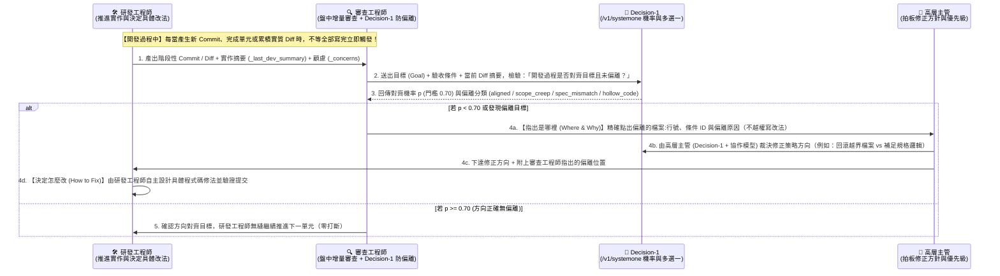

# 三角色極致扁平化、零 CLI 命名、審查工程師盤中增量介入與閉環溝通計畫

- **Objective:** 將原本 6～7 個散亂角色徹底扁平化收斂為 **「高層主管 (`supervisor`)」、「研發工程師 (`developer`)」、「審查工程師 (`reviewer`)」** 三位核心角色；**徹底清除所有角色與選項上的 `CLI` 字樣開頭或後綴**；提供明確的 **Decision-1 雙模型協作選擇器** 與滑鼠懸停職責說明（Tooltip）；讓 **審查工程師在開發過程中即時增量介入（不等到最後才審）並透過 `Decision-1` 檢查是否偏離目標**——一旦發現偏離，由 **審查工程師指出具體偏離位置（Where & Why）**，再交由 **高層主管拍板策略方向、研發工程師決定具體怎麼改（How to Fix）**，形成嚴密的三方閉環串流。

---

## 一、Decision-1 實測診斷結果總覽（`/v1/systemone`）

我們透過後端 [`ModelRouter`](file:///d:/_AI_Projs/buttonAuto/team/models.py#L316-L807) 呼叫真實 `Decision-1` 對所有架構維度進行量化審查：

| 審查維度 | Decision-1 裁決結果 | 信心度 / 機率 (`noul`) | 核心結論 |
| :--- | :--- | :---: | :--- |
| **Q0：多角色切換是否造成嚴重 Token 浪費** | **確認嚴重浪費** | **`0.9994` (99.94%)** | 開工前 `PO` → `Tech Lead` → `Scrum` 分三輪重複餵 Context + `_role_note` 旁白生成，還沒寫半行 Code 就燒掉 2～3 倍 Token。 |
| **Q1：雙模型協作 UI 與路由設計** | **`explicit_partner_selector`** | **`0.9941` (99.41%)** | 高層主管固定以 `Decision-1` 為機率裁決核心，並提供明確下拉選單讓使用者選擇「與 Decision-1 合作的生成模型（預設 `GLM-5.3`）」。 |
| **Q2：全面收斂為三角色 + 徹底清除 `CLI` 字樣 + 懸停說明** | **確認全面收斂** | **`0.9988` (99.88%)** | 角色與面板標題嚴禁帶 `CLI` 開頭或字樣（統一為 **高層主管、研發工程師、審查工程師**；工具名稱亦純淨化為 `Claude`、`Kiro`、`Antigravity`、`GLM-5.3`），滑鼠懸停顯示職責。 |
| **Q3：審查工程師盤中增量介入 + Decision-1 防偏離機制** | **`milestone_and_final_d1_review`** | **`0.9968` (99.68%)** | 審查工程師不等到最後才審！在開發途中每產生新 Commit 或里程碑變更時即介入，並用 `Decision-1` 檢驗是否偏離目標。 |
| **Q4：發現偏離時的三角色分工（指出哪裡 vs 決定怎麼改）** | **確認三方職責分立** | **`0.9149` (91.49%)** | **審查工程師**只負責指出「哪裡偏離目標（`檔案:行號` 與原因）」，接著交由**高層主管**拍板修正方向、**研發工程師**決定具體程式碼怎麼改。 |
| **Q5：三角色跨角色溝通串流（Communication Stream）斷點檢查** | **`closed_loop_3_role_stream`** | **`0.9996` (99.96%)** | 抓出 `runner.py` 中 `_concerns` 從未賦值傳遞、`_last_dev_summary` 未進正式審查 Prompt、`queue_for_impl=False` 漏傳審查建議等 **5 大真實斷點**。 |
| **Q6：Compound Engineering (`ce-*`) 整合缺口** | **確認存在 3 大缺口** | **`0.9985` (99.85%)** | ① 既有 `docs/plans/*.md` 未短路空轉；② 研發與除錯技能被拆碎且缺 `ce-commit`；③ 審查通過時未將 `ce-compound` 沉澱自動寫入知識庫。 |

---

## 二、審查工程師「盤中增量介入 ＋ Decision-1 目標對齊檢驗 ＋ 三角色協同修正」設計（`noul = 0.9968`）

原本在 [`team/runner.py:530-540`](file:///d:/_AI_Projs/buttonAuto/team/runner.py#L530-L540) 中，**審查工程師 (`reviewer`)** 只有在整個 `_build()` 全部跑完、且 `_test()` 整套測試通過後的最後一刻（`stage == "review"`）才會起床工作。這導致如果研發工程師在第 1 個 Commit 就偏離目標，要等到最後才被推翻重來。

### 改造後的「盤中增量審查（Incremental Checkpoint Review）」與三角色職責分際：

1. **介入時機（不再等到全部完成才審）**：
   - **盤中增量檢查點（Mid-Build Checkpoint）**：在 `_build()` 每回合結束時，只要偵測到 **有新增 Commit** 或 **有實質程式碼 Diff**，**審查工程師** 立即在盤中介入執行輕量快速的增量目標對齊審查（`_checkpoint_review`）。
   - **測試後完整審查（Pre-Merge Full Review）**：通過測試關卡後，執行完整 diff 的深度唯讀審查（`_review_stage`），同樣先經過 `Decision-1` 目標偏離檢驗。
2. **用 `Decision-1` 確保不偏離目標**：
   - 在盤中與最終審查中，審查工程師皆呼叫 `Decision-1`：
     - `probability`：評估當前改動是否緊密對齊 `room.goal` 與 `room.criteria`（門檻 `0.70`）。
     - `choose`：若機率低於門檻，由 `Decision-1` 判定偏離型態（`scope_creep` 越界修改無關邏輯、`spec_mismatch` 偏離目標規格、`hollow_code` 空殼或假資料）。
3. **三角色糾偏分工（「審查指出哪裡」➔「主管定方向」➔「研發決定怎麼改」）**：
   - **🔍 審查工程師 (`reviewer`)**：**只負責指出「哪裡偏離了目標（Where & Why）」**——輸出具體的 `檔案:行號`、偏離了哪一條目標／條件、以及客觀證據，**絕不越俎代庖替研發工程師寫程式碼或硬性規定死板改法**。
   - **👔 高層主管 (`supervisor`)**：收到審查工程師的偏離報告後，透過 `Decision-1` + 協作生成模型決定**修正策略方向**（並檢查是否連續 2 輪卡在同一問題而需啟動斷路器）。
   - **🛠️ 研發工程師 (`developer`)**：收到「審查工程師指出的偏離位置」與「高層主管的策略方向」後，由**研發工程師自己決定具體要怎麼改程式碼（How to Fix）**。

---

## 三、Decision-1 抓出的「三角色溝通串流」5 大真實程式碼斷點修復（`noul = 0.9996`）

| 斷點編號 | 程式碼位置 | 原本發生的溝通斷裂問題 | 閉環修復方案（Closed-Loop Fix） |
| :--- | :--- | :--- | :--- |
| **斷點 A** | [`runner.py:326`](file:///d:/_AI_Projs/buttonAuto/team/runner.py#L326) [`runner.py:2604`](file:///d:/_AI_Projs/buttonAuto/team/runner.py#L2604) | **`self._concerns` 是死變數！** 只在 L326 初始化為 `[]`，`_build()` 從未解析研發工程師 JSON 回報的 `"concerns"`，且 `_review_once()` 呼叫 `personas.review()` 時也漏傳 `concerns=self._concerns`，導致研發工程師提出的顧慮，審查工程師完全看不到。 | 在 `_build()` 自動解析研發工程師 JSON 的 `concerns` 存入 `self._concerns`，並在盤中審查與 `_review_once()` 正式傳入 `personas.review(..., concerns=self._concerns)`。 |
| **斷點 B** | [`runner.py:2532`](file:///d:/_AI_Projs/buttonAuto/team/runner.py#L2532) [`runner.py:2604`](file:///d:/_AI_Projs/buttonAuto/team/runner.py#L2604) | **研發工程師交接摘要 `_last_dev_summary` 沒進正式審查 Prompt！** 原本只傳給 `_role_note` 寫 200 字旁白，一旦關閉旁白，審查工程師根本不知道研發工程師剛才做了什麼。 | 在 `personas.review()` 與 `Composer.review()` 新增 `dev_summary` 欄位，將 `_last_dev_summary` 直接放進審查工程師的 `【本次資料】` 圍欄中。 |
| **斷點 C** | [`runner.py:2577`](file:///d:/_AI_Projs/buttonAuto/team/runner.py#L2577) | **審查退回時 `queue_for_impl=False` 且漏傳 `suggestions`！** 審查工程師退回時，跨角色溝通未排入 `_pending_comm_msgs`，且只傳 `blocking` 漏了 `suggestions`。 | 審查退回（含盤中偏離警告）時設為 `queue_for_impl=True, emit_say=True`，先交由高層主管裁決方向，再將「偏離位置 + 主管方向 + 建議」排入研發工程師下一回合。 |
| **斷點 D** | [`runner.py:1006`](file:///d:/_AI_Projs/buttonAuto/team/runner.py#L1006) [`personas.py:18`](file:///d:/_AI_Projs/buttonAuto/team/personas.py#L18) | **跨角色溝通署名混亂**：還在用 `PO`、`Tech Lead`、`Scrum`、`QA`、`實作工程師`、`獨立審查員` 等 7 種稱呼，甚至 `build()` 用 `Tech Lead` 署名。 | 全面正規化為 **`【高層主管】`**、**`【研發工程師】`**、**`【審查工程師】`** 三方署名與路由。 |
| **斷點 E** | [`prompt_defaults.py:192`](file:///d:/_AI_Projs/buttonAuto/team/prompt_defaults.py#L192) [`runner.py:2550`](file:///d:/_AI_Projs/buttonAuto/team/runner.py#L2550) | **`ce-compound` 知識未回流**：審查工程師 JSON 契約缺少 `compound_learnings`，通過審查時沒有把提煉的經驗寫入知識庫。 | 在審查 JSON 契約補上 `"compound_learnings": [...]`，審查後自動寫入 `LessonBook` 與 `LLM Wiki` (`docs/solutions/`)，並在退回重修時同步餵給研發工程師。 |

---

## 四、徹底消除「CLI」開頭與怪異字樣（Zero-CLI Role Naming，`noul = 0.9988`）

| 介面 / 程式碼位置 | ❌ 修改前（帶有 `CLI` 或散亂角色） | ✅ 修改後（純淨三角色，零 `CLI` 開頭） |
| :--- | :--- | :--- |
| **區塊標題**（[`DispatchWizard.tsx`](file:///d:/_AI_Projs/buttonAuto/pixeloffice/components/DispatchWizard.tsx)、[`SessionPanel.tsx`](file:///d:/_AI_Projs/buttonAuto/pixeloffice/components/SessionPanel.tsx)） | `CLI 開發／審查工程師與模型配置` | **`團隊角色與模型配置（高層主管・研發工程師・審查工程師）`** |
| **角色 1：高層主管** | 拆成 `PO`、`Tech Lead`、`Scrum Master`、`QA` 四列 | 左欄：**`👔 高層主管（主決策：Decision-1）`** 右欄：**`🤝 與 Decision-1 協作的生成模型`**（預設 `glm-5.3`，可任選） |
| **角色 2：研發工程師** | `🛠️ 實作 CLI 座位` / `實作模型` | 左欄：**`🛠️ 研發工程師`** 右欄：**`研發工程師 模型`** |
| **角色 3：審查工程師** | `🔍 審查 CLI 座位` / `審查模型` | 左欄：**`🔍 審查工程師`** 右欄：**`審查工程師 模型`** |
| **工具選項與畫布標籤**（[`pixelRoomScene.ts`](file:///d:/_AI_Projs/buttonAuto/pixeloffice/lib/pixelRoomScene.ts)） | `Claude CLI`、`Kiro CLI`、`Antigravity CLI`、`CLI 開發代理`、`CLI 審查代理`、`GLM-5.3（代班 CLI）` | **`Claude`**、**`Kiro`**、**`Antigravity`**、**`研發工程師`**、**`審查工程師`**、**`GLM-5.3（自動代班）`** |

---

## 五、三角色職責、滑鼠懸停說明（Tooltip）與 Compound Engineering 整合表

| 角色名稱 | 滑鼠移到名稱上浮現的說明（Hover Tooltip） | 綁定之 `compound-engineering` (`ce-*`) 技能 |
| :--- | :--- | :--- |
| **👔 高層主管** | **高層主管（雙模型協作大腦）**：由 `Decision-1`（機率與多選一裁決引擎）搭配你選擇的「協作生成模型」（預設 `GLM-5.3`）共同運作。負責目標規格與 `docs/plans/` 計畫定錨、權限安全把關、回答研發提問，並在審查工程師指出目標偏離時拍板修正策略方向。 | `ce-brainstorm`、`ce-strategy`、`ce-plan`、`ce-doc-review` |
| **🛠️ 研發工程師** | **研發工程師（全流程實作與除錯）**：負責依據高層主管核定的計畫與驗收條件，一氣呵成完成 TDD 測試撰寫、功能實作、根因除錯、程式碼精簡與 Git Commit；當審查工程師指出偏離位置與高層主管決定方向後，由研發工程師決定具體程式碼怎麼改。 | `ce-work`、`ce-debug`、`ce-simplify-code`、`ce-test-browser`、`ce-commit` |
| **🔍 審查工程師** | **審查工程師（盤中增量防偏離 ＋ 唯讀獨立審查）**：不等到全部做完才審！在開發過程中每有新進度即透過 `Decision-1` 檢查是否偏離目標；一旦發現偏離或漏洞，負責精確指出「是哪裡偏離（檔案:行號與原因）」，交由高層主管與研發工程師決定怎麼改，並將經驗沉澱至 LLM Wiki。 | `ce-code-review`、`ce-compound` |

---

## 六、實施單元分解（Implementation Units）

### Unit 1：後端三角色收斂、零 CLI 標籤、審查「指出哪裡而非代改」Prompt 契約與 CE 對齊 (`team/ce_skills.py`, `team/prompt_defaults.py`, `team/personas.py`, `team/fleet.py`)
- **目標**：
  1. 將角色定義、提示詞署名、CE 技能規範統一為 **高層主管 (`supervisor`)、研發工程師 (`developer`/`implementer`)、審查工程師 (`reviewer`)**，徹底移除 `CLI` 字樣。
  2. 更新審查工程師的 Prompt 與契約：明確規定審查工程師的職責是 **「利用 `Decision-1` 對照目標，精確指出哪裡偏離目標或有漏洞（`檔案:行號` 與原因），把『怎麼改』的決定權交還給高層主管與研發工程師」**，並新增 `drift_locations` 與 `compound_learnings` JSON 欄位。
- **驗收方式**：`python -m pytest tests/team/ -k "persona or prompt or ce" -v`

### Unit 2：審查工程師盤中增量介入（`_checkpoint_review` + `Decision-1` 防偏離）、三角色閉環溝通串流與省 Token 扁平化流程 (`team/runner.py`, `team/models.py`, `team/office.py`)
- **目標**：
  1. 在 `runner.py:_build()` 實作 **審查工程師盤中增量介入（`_checkpoint_review`）**：每當研發工程師產生新 Commit 或累積實質程式碼變更時，審查工程師立即結合 `Decision-1` 檢驗是否偏離目標；若偏離則指出具體位置（Where & Why）➔ 高層主管拍板修正方針 ➔ 研發工程師決定具體改法。
  2. 修復 **5 大跨角色溝通串流斷點**（`_concerns`、`_last_dev_summary`、`queue_for_impl=True`、統一三角色署名、`compound_learnings` 自動寫入知識庫）。
  3. 扁平化開工流程（直接掛載既有 `docs/plans/` 或由高層主管單次定錨規格與計畫，省去冗餘旁白與多輪空轉）。
- **驗收方式**：`python -m pytest tests/team/ -v`

### Unit 3：前端三角色 UI（零 CLI 開頭）、`Decision-1` 協作模型選擇器與滑鼠懸停說明 Tooltip (`SessionPanel.tsx`, `DispatchWizard.tsx`, `pixelRoomScene.ts`)
- **目標**：
  1. 在 `DispatchWizard.tsx` 與 `SessionPanel.tsx` 將 6 列角色改為 **3 列（👔 高層主管、🛠️ 研發工程師、🔍 審查工程師）**，徹底清除所有 `CLI` 開頭的角色或選項名稱。
  2. 在 **👔 高層主管** 列提供明確的 **「主決策：`Decision-1` ＋ 與 Decision-1 協作的生成模型」** 選擇器。
  3. 為三個角色名稱與像素房間卡片加上滑鼠懸停職責說明（Tooltip）。
  4. 在 `pixelRoomScene.ts` 固定三位像素人的職稱為 `高層主管`、`研發工程師`、`審查工程師`（當盤中增量審查觸發時，像素房間裡的審查工程師也會走到電腦前亮燈審查！），並重新建置匯出至 `web/pixel`。
- **驗收方式**：`npm --prefix pixeloffice test`、`npm --prefix pixeloffice run build`、`python -m pytest tests/test_pixel_ui.py -v`
