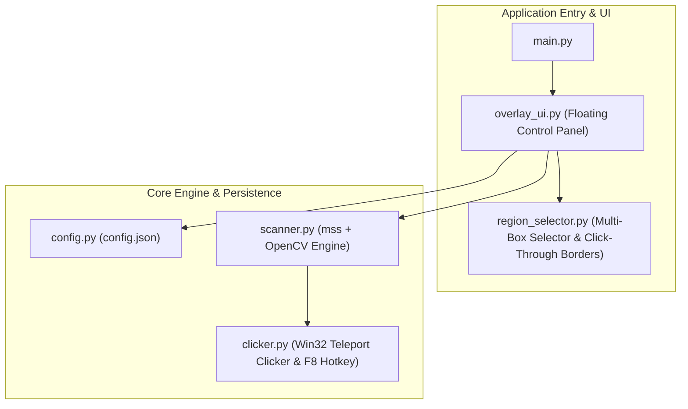

# ButtonAuto (Windows 智慧按鈕精靈) Implementation Plan

> **For agentic workers:** REQUIRED SUB-SKILL: Use superpowers:subagent-driven-development to implement this plan task-by-task. Steps use checkbox (`- [ ]`) syntax for tracking.

**Goal:** Build a lightweight Windows auto-button clicker in Python that scans multiple screen regions (or full screen) at a configurable interval for multiple target button templates (`Submit` dark/light + custom cropped targets), clicks matches via Win32 cursor teleportation + restoration, and provides an always-on-top Tkinter floating control panel.

**Architecture:** The application is split into four focused modules: `config.py` (JSON persistence for scan settings, multi-regions, and multi-targets), `clicker.py` (Win32 DPI awareness, instant cursor teleport-click-restore, cooldown protection, and global `F8` hotkey listener), `scanner.py` (`mss` screen capture + OpenCV `TM_CCOEFF_NORMED` template matching with self-window exclusion), and `region_selector.py` + `overlay_ui.py` (Tkinter topmost control panel, interactive multi-box screen selector for both scan regions and new target buttons, and click-through region border overlays).

**Architecture Diagram:**



**Tech Stack:** Python 3.13, `opencv-python` (`cv2`), `mss`, `Pillow` (`PIL`), `numpy`, `tkinter`, `ctypes` (`windll.user32`, `windll.shcore`), `pytest`

## Global Constraints

- Target OS: Windows (uses `ctypes.windll.user32` and `ctypes.windll.shcore` for Per-Monitor DPI awareness, mouse teleport/click, click-through window styles, and `VK_F8` polling).
- All file paths containing non-ASCII characters (such as Chinese filenames or directory paths) MUST be loaded using `np.fromfile` + `cv2.imdecode` instead of `cv2.imread` to prevent OpenCV path encoding failures on Windows.
- Self-window exclusion: Any template match whose center falls inside the floating control panel's bounding box `(wx, wy, ww, wh)` MUST be ignored so the clicker never clicks its own target preview thumbnails.

---

### Task 1: Environment Setup, Config Module, and Win32 Clicker Module

**Files:**
- Create: `requirements.txt`
- Create: `config.py`
- Create: `clicker.py`
- Test: `tests/test_config_and_clicker.py`

**Interfaces:**
- Produces:
  - `config.AppConfig`: dataclass/class with `.load(path) -> AppConfig`, `.save(path) -> None`, fields `scan_interval: float`, `threshold: float`, `multi_scale: bool`, `show_region_borders: bool`, `cooldown_sec: float`, `regions: list[dict]`, `targets: list[dict]`.
  - `clicker.enable_dpi_awareness() -> None`
  - `clicker.get_cursor_pos() -> tuple[int, int]`
  - `clicker.set_cursor_pos(x: int, y: int) -> None`
  - `clicker.ClickController`: class with `.click_and_restore(x: int, y: int, cooldown_sec: float = 0.8) -> bool` and `.is_f8_pressed() -> bool`.

- [ ] **Step 1: Write the failing test in `tests/test_config_and_clicker.py`**

```python
import os
import json
import time
import pytest
from config import AppConfig
from clicker import ClickController, get_cursor_pos, set_cursor_pos


def test_config_default_and_persistence(tmp_path):
    cfg_file = tmp_path / "config.json"
    cfg = AppConfig.load(str(cfg_file))
    assert cfg.scan_interval == 1.0
    assert cfg.threshold == 0.85
    assert len(cfg.targets) == 2
    assert cfg.regions == []

    cfg.scan_interval = 0.5
    cfg.regions.append({"x": 10, "y": 20, "w": 300, "h": 200, "enabled": True})
    cfg.save(str(cfg_file))

    reloaded = AppConfig.load(str(cfg_file))
    assert reloaded.scan_interval == 0.5
    assert len(reloaded.regions) == 1
    assert reloaded.regions[0]["w"] == 300


def test_click_controller_cooldown_and_cursor_restore(monkeypatch):
    calls = []
    fake_pos = [500, 600]

    def mock_get_pos():
        return (fake_pos[0], fake_pos[1])

    def mock_set_pos(x, y):
        calls.append(("move", x, y))
        fake_pos[0], fake_pos[1] = x, y

    def mock_mouse_event(flags, dx, dy, data, extra):
        calls.append(("event", flags))

    monkeypatch.setattr("clicker.get_cursor_pos", mock_get_pos)
    monkeypatch.setattr("clicker.set_cursor_pos", mock_set_pos)
    monkeypatch.setattr("clicker._send_mouse_event", mock_mouse_event)

    ctrl = ClickController()
    clicked = ctrl.click_and_restore(100, 200, cooldown_sec=0.5)
    assert clicked is True
    assert calls[0] == ("move", 100, 200)
    assert calls[-1] == ("move", 500, 600)

    # Immediate second click at same position should be blocked by cooldown
    clicked_again = ctrl.click_and_restore(102, 198, cooldown_sec=0.5)
    assert clicked_again is False
```

- [ ] **Step 2: Run test to verify it fails**

Run: `pytest tests/test_config_and_clicker.py -v`
Expected: FAIL with `ModuleNotFoundError: No module named 'config'`

- [ ] **Step 3: Write `requirements.txt`, `config.py`, and `clicker.py`**

Create `requirements.txt`:
```text
opencv-python>=4.8.0
mss>=9.0.0
Pillow>=10.0.0
numpy>=1.26.0
pytest>=8.0.0
```

Create `config.py`:
```python
import json
import os
from dataclasses import dataclass, field, asdict
from typing import List, Dict, Any

DEFAULT_CONFIG_PATH = os.path.join(os.path.dirname(os.path.abspath(__file__)), "config.json")


def _default_targets() -> List[Dict[str, Any]]:
    return [
        {"name": "Submit (深色)", "path": "targets/submit_dark.png", "enabled": True},
        {"name": "Submit (淺色)", "path": "targets/submit_light.png", "enabled": True},
    ]


@dataclass
class AppConfig:
    scan_interval: float = 1.0
    threshold: float = 0.85
    multi_scale: bool = False
    show_region_borders: bool = True
    cooldown_sec: float = 0.8
    regions: List[Dict[str, Any]] = field(default_factory=list)
    targets: List[Dict[str, Any]] = field(default_factory=_default_targets)

    @classmethod
    def load(cls, path: str = DEFAULT_CONFIG_PATH) -> "AppConfig":
        if not os.path.exists(path):
            cfg = cls()
            cfg.save(path)
            return cfg
        try:
            with open(path, "r", encoding="utf-8") as f:
                data = json.load(f)
            return cls(
                scan_interval=float(data.get("scan_interval", 1.0)),
                threshold=float(data.get("threshold", 0.85)),
                multi_scale=bool(data.get("multi_scale", False)),
                show_region_borders=bool(data.get("show_region_borders", True)),
                cooldown_sec=float(data.get("cooldown_sec", 0.8)),
                regions=list(data.get("regions", [])),
                targets=list(data.get("targets", _default_targets())),
            )
        except Exception:
            return cls()

    def save(self, path: str = DEFAULT_CONFIG_PATH) -> None:
        os.makedirs(os.path.dirname(os.path.abspath(path)), exist_ok=True)
        with open(path, "w", encoding="utf-8") as f:
            json.dump(asdict(self), f, ensure_ascii=False, indent=2)
```

Create `clicker.py`:
```python
import ctypes
import ctypes.wintypes
import time
from typing import Tuple

MOUSEEVENTF_LEFTDOWN = 0x0002
MOUSEEVENTF_LEFTUP = 0x0004
VK_F8 = 0x77


def enable_dpi_awareness() -> None:
    try:
        ctypes.windll.shcore.SetProcessDpiAwareness(2)
    except Exception:
        try:
            ctypes.windll.user32.SetProcessDPIAware()
        except Exception:
            pass


def get_cursor_pos() -> Tuple[int, int]:
    pt = ctypes.wintypes.POINT()
    ctypes.windll.user32.GetCursorPos(ctypes.byref(pt))
    return pt.x, pt.y


def set_cursor_pos(x: int, y: int) -> None:
    ctypes.windll.user32.SetCursorPos(int(x), int(y))


def _send_mouse_event(flags: int, dx: int = 0, dy: int = 0, data: int = 0, extra: int = 0) -> None:
    ctypes.windll.user32.mouse_event(flags, dx, dy, data, extra)


class ClickController:
    def __init__(self) -> None:
        self._last_click_time: float = 0.0
        self._last_click_pos: Tuple[int, int] = (-9999, -9999)
        self._f8_was_down: bool = False

    def click_and_restore(self, x: int, y: int, cooldown_sec: float = 0.8) -> bool:
        now = time.monotonic()
        lx, ly = self._last_click_pos
        if (now - self._last_click_time) < cooldown_sec and abs(x - lx) < 25 and abs(y - ly) < 25:
            return False

        orig_x, orig_y = get_cursor_pos()
        set_cursor_pos(x, y)
        time.sleep(0.006)
        _send_mouse_event(MOUSEEVENTF_LEFTDOWN)
        time.sleep(0.006)
        _send_mouse_event(MOUSEEVENTF_LEFTUP)
        time.sleep(0.006)
        set_cursor_pos(orig_x, orig_y)

        self._last_click_time = time.monotonic()
        self._last_click_pos = (x, y)
        return True

    def poll_f8_toggled(self) -> bool:
        try:
            state = ctypes.windll.user32.GetAsyncKeyState(VK_F8)
            is_down = bool(state & 0x8000)
            toggled = is_down and not self._f8_was_down
            self._f8_was_down = is_down
            return toggled
        except Exception:
            return False
```

- [ ] **Step 4: Run test to verify it passes**

Run: `pytest tests/test_config_and_clicker.py -v`
Expected: PASS

- [ ] **Step 5: Commit**

```bash
git add requirements.txt config.py clicker.py tests/test_config_and_clicker.py
git commit -m "feat: add config persistence and Win32 teleport clicker module"
```

---

### Task 2: OpenCV + mss Multi-Region & Multi-Target Scanner Engine

**Files:**
- Create: `scanner.py`
- Test: `tests/test_scanner.py`

**Interfaces:**
- Consumes: `targets/submit_dark.png`, `targets/submit_light.png`
- Produces:
  - `scanner.MatchResult`: dataclass with `x: int`, `y: int`, `score: float`, `target_name: str`, `region_index: int`
  - `scanner.ScreenScanner`: class with `.load_templates(targets: list[dict], base_dir: str) -> None`, `.find_matches_in_image(img_bgr: np.ndarray, offset_x: int, offset_y: int, threshold: float, multi_scale: bool, exclude_rect: tuple[int, int, int, int] | None) -> list[MatchResult]`, and `.scan_screen(regions: list[dict], threshold: float, multi_scale: bool, exclude_rect: tuple[int, int, int, int] | None) -> list[MatchResult]`

- [ ] **Step 1: Write the failing test in `tests/test_scanner.py`**

```python
import os
import cv2
import numpy as np
from scanner import ScreenScanner, read_image_unicode

BASE_DIR = os.path.dirname(os.path.dirname(os.path.abspath(__file__)))


def test_find_submit_buttons_and_exclude_self_window():
    scanner = ScreenScanner()
    targets = [
        {"name": "Submit (深色)", "path": "targets/submit_dark.png", "enabled": True},
        {"name": "Submit (淺色)", "path": "targets/submit_light.png", "enabled": True},
    ]
    scanner.load_templates(targets, BASE_DIR)

    # Create a synthetic 800x600 screen canvas
    canvas = np.zeros((600, 800, 3), dtype=np.uint8)
    dark_btn = read_image_unicode(os.path.join(BASE_DIR, "targets", "submit_dark.png"))
    light_btn = read_image_unicode(os.path.join(BASE_DIR, "targets", "submit_light.png"))

    dh, dw = dark_btn.shape[:2]
    lh, lw = light_btn.shape[:2]

    # Place dark button at (100, 150) and light button at (450, 320)
    canvas[150:150 + dh, 100:100 + dw] = dark_btn
    canvas[320:320 + lh, 450:450 + lw] = light_btn

    matches = scanner.find_matches_in_image(
        canvas, offset_x=0, offset_y=0, threshold=0.85, multi_scale=False, exclude_rect=None
    )
    assert len(matches) == 2

    expected_dark_center = (100 + dw // 2, 150 + dh // 2)
    expected_light_center = (450 + lw // 2, 320 + lh // 2)

    centers = [(m.x, m.y) for m in matches]
    assert any(abs(cx - expected_dark_center[0]) <= 2 and abs(cy - expected_dark_center[1]) <= 2 for cx, cy in centers)
    assert any(abs(cx - expected_light_center[0]) <= 2 and abs(cy - expected_light_center[1]) <= 2 for cx, cy in centers)

    # Now exclude the region covering the first button (simulating the floating control panel)
    matches_excluded = scanner.find_matches_in_image(
        canvas, offset_x=0, offset_y=0, threshold=0.85, multi_scale=False, exclude_rect=(80, 130, 200, 100)
    )
    assert len(matches_excluded) == 1
    assert abs(matches_excluded[0].x - expected_light_center[0]) <= 2
```

- [ ] **Step 2: Run test to verify it fails**

Run: `pytest tests/test_scanner.py -v`
Expected: FAIL with `ModuleNotFoundError: No module named 'scanner'`

- [ ] **Step 3: Write `scanner.py`**

```python
import os
from dataclasses import dataclass
from typing import List, Dict, Any, Optional, Tuple
import cv2
import numpy as np
import mss


@dataclass
class MatchResult:
    x: int
    y: int
    score: float
    target_name: str
    region_index: int = -1


def read_image_unicode(path: str) -> Optional[np.ndarray]:
    if not os.path.exists(path):
        return None
    try:
        raw = np.fromfile(path, dtype=np.uint8)
        img = cv2.imdecode(raw, cv2.IMREAD_COLOR)
        return img
    except Exception:
        return None


def write_image_unicode(path: str, img_bgr: np.ndarray) -> bool:
    try:
        os.makedirs(os.path.dirname(os.path.abspath(path)), exist_ok=True)
        ok, buf = cv2.imencode(".png", img_bgr)
        if not ok:
            return False
        buf.tofile(path)
        return True
    except Exception:
        return False


class ScreenScanner:
    def __init__(self) -> None:
        self._templates: List[Dict[str, Any]] = []

    def load_templates(self, targets: List[Dict[str, Any]], base_dir: str) -> None:
        loaded: List[Dict[str, Any]] = []
        for t in targets:
            if not t.get("enabled", True):
                continue
            rel_or_abs = t.get("path", "")
            full_path = rel_or_abs if os.path.isabs(rel_or_abs) else os.path.join(base_dir, rel_or_abs)
            img = read_image_unicode(full_path)
            if img is not None and img.size > 0:
                loaded.append({
                    "name": t.get("name", os.path.basename(full_path)),
                    "path": rel_or_abs,
                    "img": img,
                    "h": img.shape[0],
                    "w": img.shape[1],
                })
        self._templates = loaded

    def find_matches_in_image(
        self,
        img_bgr: np.ndarray,
        offset_x: int = 0,
        offset_y: int = 0,
        threshold: float = 0.85,
        multi_scale: bool = False,
        exclude_rect: Optional[Tuple[int, int, int, int]] = None,
        region_index: int = -1,
    ) -> List[MatchResult]:
        results: List[MatchResult] = []
        ih, iw = img_bgr.shape[:2]
        scales = [0.9, 0.95, 1.0, 1.05, 1.1] if multi_scale else [1.0]

        for tmpl in self._templates:
            base_img = tmpl["img"]
            best_score = -1.0
            best_center: Optional[Tuple[int, int]] = None

            for scale in scales:
                if abs(scale - 1.0) < 1e-4:
                    t_img = base_img
                else:
                    nw = max(8, int(tmpl["w"] * scale))
                    nh = max(8, int(tmpl["h"] * scale))
                    t_img = cv2.resize(base_img, (nw, nh), interpolation=cv2.INTER_AREA)

                th, tw = t_img.shape[:2]
                if ih < th or iw < tw:
                    continue

                res = cv2.matchTemplate(img_bgr, t_img, cv2.TM_CCOEFF_NORMED)
                _, max_val, _, max_loc = cv2.minMaxLoc(res)
                if max_val >= threshold and max_val > best_score:
                    cx = offset_x + max_loc[0] + tw // 2
                    cy = offset_y + max_loc[1] + th // 2
                    if exclude_rect is not None:
                        ex, ey, ew, eh = exclude_rect
                        if ex <= cx <= (ex + ew) and ey <= cy <= (ey + eh):
                            continue
                    best_score = float(max_val)
                    best_center = (cx, cy)

            if best_center is not None:
                # Avoid duplicate detections of same physical button across dark/light templates
                if not any(abs(r.x - best_center[0]) < 20 and abs(r.y - best_center[1]) < 20 for r in results):
                    results.append(
                        MatchResult(
                            x=best_center[0],
                            y=best_center[1],
                            score=best_score,
                            target_name=tmpl["name"],
                            region_index=region_index,
                        )
                    )

        results.sort(key=lambda r: r.score, reverse=True)
        return results

    def scan_screen(
        self,
        regions: List[Dict[str, Any]],
        threshold: float = 0.85,
        multi_scale: bool = False,
        exclude_rect: Optional[Tuple[int, int, int, int]] = None,
    ) -> List[MatchResult]:
        if not self._templates:
            return []

        active_regions = [r for r in regions if r.get("enabled", True) and r.get("w", 0) > 10 and r.get("h", 0) > 10]
        all_matches: List[MatchResult] = []

        with mss.mss() as sct:
            if not active_regions:
                # Scan virtual full screen (all monitors combined, index 0)
                mon = sct.monitors[0]
                raw = np.array(sct.grab(mon))
                img_bgr = cv2.cvtColor(raw, cv2.COLOR_BGRA2BGR)
                return self.find_matches_in_image(
                    img_bgr,
                    offset_x=mon["left"],
                    offset_y=mon["top"],
                    threshold=threshold,
                    multi_scale=multi_scale,
                    exclude_rect=exclude_rect,
                    region_index=-1,
                )

            for idx, reg in enumerate(active_regions):
                bbox = {
                    "left": int(reg["x"]),
                    "top": int(reg["y"]),
                    "width": int(reg["w"]),
                    "height": int(reg["h"]),
                }
                try:
                    raw = np.array(sct.grab(bbox))
                    img_bgr = cv2.cvtColor(raw, cv2.COLOR_BGRA2BGR)
                    matches = self.find_matches_in_image(
                        img_bgr,
                        offset_x=bbox["left"],
                        offset_y=bbox["top"],
                        threshold=threshold,
                        multi_scale=multi_scale,
                        exclude_rect=exclude_rect,
                        region_index=idx,
                    )
                    for m in matches:
                        if not any(abs(existing.x - m.x) < 20 and abs(existing.y - m.y) < 20 for existing in all_matches):
                            all_matches.append(m)
                except Exception:
                    continue

        all_matches.sort(key=lambda r: r.score, reverse=True)
        return all_matches
```

- [ ] **Step 4: Run test to verify it passes**

Run: `pytest tests/test_scanner.py -v`
Expected: PASS

- [ ] **Step 5: Commit**

```bash
git add scanner.py tests/test_scanner.py
git commit -m "feat: add OpenCV + mss multi-region and multi-target screen scanner"
```

---

### Task 3: Multi-Box Interactive Region/Target Selector & Click-Through Region Overlays

**Files:**
- Create: `region_selector.py`
- Test: `tests/test_region_selector.py`

**Interfaces:**
- Produces:
  - `region_selector.normalize_box(x1: int, y1: int, x2: int, y2: int, min_size: int = 12) -> dict | None`
  - `region_selector.MultiBoxSelector`: Tkinter fullscreen overlay allowing the user to drag and draw multiple boxes in one session (`Enter` or `Right-Click` to confirm all drawn boxes, `Esc` to cancel, `BackSpace` to undo last box).
  - `region_selector.RegionBorderOverlayManager`: creates/updates click-through (`WS_EX_LAYERED | WS_EX_TRANSPARENT | WS_EX_TOPMOST | WS_EX_TOOLWINDOW`) green border windows on Windows so the user can see their active scan regions without blocking mouse clicks.

- [ ] **Step 1: Write the failing test in `tests/test_region_selector.py`**

```python
from region_selector import normalize_box


def test_normalize_box_handles_reverse_drag_and_min_size():
    # Dragging from bottom-right to top-left
    box = normalize_box(300, 400, 100, 150, min_size=12)
    assert box == {"x": 100, "y": 150, "w": 200, "h": 250, "enabled": True}

    # Too small accidental click should return None
    tiny = normalize_box(50, 50, 55, 58, min_size=12)
    assert tiny is None
```

- [ ] **Step 2: Run test to verify it fails**

Run: `pytest tests/test_region_selector.py -v`
Expected: FAIL with `ModuleNotFoundError: No module named 'region_selector'`

- [ ] **Step 3: Write `region_selector.py`**

```python
import ctypes
import tkinter as tk
from typing import List, Dict, Any, Optional, Callable
import cv2
import mss
import numpy as np
from PIL import Image, ImageTk

GWL_EXSTYLE = -20
WS_EX_LAYERED = 0x00080000
WS_EX_TRANSPARENT = 0x00000020
WS_EX_TOOLWINDOW = 0x00000080
WS_EX_TOPMOST = 0x00000008


def normalize_box(x1: int, y1: int, x2: int, y2: int, min_size: int = 12) -> Optional[Dict[str, Any]]:
    left = min(int(x1), int(x2))
    top = min(int(y1), int(y2))
    w = abs(int(x2) - int(x1))
    h = abs(int(y2) - int(y1))
    if w < min_size or h < min_size:
        return None
    return {"x": left, "y": top, "w": w, "h": h, "enabled": True}


class MultiBoxSelector:
    """
    Fullscreen frozen-screen overlay that allows dragging multiple bounding boxes.
    - Left mouse drag: draw a box (can draw multiple boxes in a row)
    - Backspace / Delete: remove the last drawn box
    - Enter / Space / Right-click: confirm and return all drawn boxes + cropped BGR images
    - Escape: cancel
    """

    def __init__(
        self,
        parent: tk.Misc,
        mode_title: str,
        box_color: str = "#00FF66",
        on_complete: Optional[Callable[[List[Dict[str, Any]], List[np.ndarray]], None]] = None,
    ) -> None:
        self.parent = parent
        self.mode_title = mode_title
        self.box_color = box_color
        self.on_complete = on_complete

        self.boxes: List[Dict[str, Any]] = []
        self.rect_ids: List[int] = []
        self._start_x = 0
        self._start_y = 0
        self._cur_rect_id: Optional[int] = None

        with mss.mss() as sct:
            self.mon = sct.monitors[0]
            raw = np.array(sct.grab(self.mon))
            self.screen_bgr = cv2.cvtColor(raw, cv2.COLOR_BGRA2BGR)
            screen_rgb = cv2.cvtColor(raw, cv2.COLOR_BGRA2RGB)
            # Darken background slightly so user knows they are in selection mode
            darkened = (screen_rgb.astype(np.float32) * 0.65).astype(np.uint8)
            self.pil_bg = Image.fromarray(darkened)

        self.top = tk.Toplevel(parent)
        self.top.overrideredirect(True)
        self.top.attributes("-topmost", True)
        geometry_str = f"{self.mon['width']}x{self.mon['height']}+{self.mon['left']}+{self.mon['top']}"
        self.top.geometry(geometry_str)
        self.top.configure(cursor="crosshair")

        self.tk_bg = ImageTk.PhotoImage(self.pil_bg)
        self.canvas = tk.Canvas(
            self.top,
            width=self.mon["width"],
            height=self.mon["height"],
            highlightthickness=0,
            bd=0,
        )
        self.canvas.pack(fill="both", expand=True)
        self.canvas.create_image(0, 0, anchor="nw", image=self.tk_bg)

        banner_text = (
            f"【{self.mode_title}】左鍵拖曳可連續框選多個區域  |  "
            f"Enter 或 滑鼠右鍵：完成確認  |  Backspace：復原上一個框  |  Esc：取消"
        )
        self.banner_bg = self.canvas.create_rectangle(
            20, 20, 920, 64, fill="#111827", outline=self.box_color, width=2
        )
        self.banner_label = self.canvas.create_text(
            36,
            42,
            anchor="w",
            text=banner_text,
            fill="#FFFFFF",
            font=("Microsoft JhengHei UI", 11, "bold"),
        )

        self.canvas.bind("<ButtonPress-1>", self._on_press)
        self.canvas.bind("<B1-Motion>", self._on_drag)
        self.canvas.bind("<ButtonRelease-1>", self._on_release)
        self.canvas.bind("<ButtonPress-3>", self._on_confirm)
        self.top.bind("<Return>", self._on_confirm)
        self.top.bind("<space>", self._on_confirm)
        self.top.bind("<BackSpace>", self._on_undo)
        self.top.bind("<Delete>", self._on_undo)
        self.top.bind("<Escape>", self._on_cancel)
        self.top.focus_force()

    def _on_press(self, event: tk.Event) -> None:
        self._start_x = event.x
        self._start_y = event.y
        self._cur_rect_id = self.canvas.create_rectangle(
            self._start_x,
            self._start_y,
            self._start_x,
            self._start_y,
            outline=self.box_color,
            width=2,
            dash=(4, 2),
        )

    def _on_drag(self, event: tk.Event) -> None:
        if self._cur_rect_id is not None:
            self.canvas.coords(self._cur_rect_id, self._start_x, self._start_y, event.x, event.y)

    def _on_release(self, event: tk.Event) -> None:
        if self._cur_rect_id is not None:
            self.canvas.delete(self._cur_rect_id)
            self._cur_rect_id = None

        box = normalize_box(self._start_x, self._start_y, event.x, event.y, min_size=12)
        if box is None:
            return

        # Store screen-space coordinates (accounting for multi-monitor virtual desktop offset)
        abs_box = {
            "x": box["x"] + self.mon["left"],
            "y": box["y"] + self.mon["top"],
            "w": box["w"],
            "h": box["h"],
            "_canvas_x": box["x"],
            "_canvas_y": box["y"],
            "enabled": True,
        }
        self.boxes.append(abs_box)
        idx = len(self.boxes)
        rid = self.canvas.create_rectangle(
            box["x"],
            box["y"],
            box["x"] + box["w"],
            box["y"] + box["h"],
            outline=self.box_color,
            width=3,
        )
        tid = self.canvas.create_text(
            box["x"] + 6,
            max(12, box["y"] - 10),
            anchor="w",
            text=f"#{idx} ({box['w']}x{box['h']})",
            fill=self.box_color,
            font=("Microsoft JhengHei UI", 10, "bold"),
        )
        self.rect_ids.append((rid, tid))

    def _on_undo(self, _event: Optional[tk.Event] = None) -> None:
        if self.boxes and self.rect_ids:
            self.boxes.pop()
            rid, tid = self.rect_ids.pop()
            self.canvas.delete(rid)
            self.canvas.delete(tid)

    def _on_confirm(self, _event: Optional[tk.Event] = None) -> None:
        clean_boxes: List[Dict[str, Any]] = []
        crops: List[np.ndarray] = []
        for b in self.boxes:
            cx, cy, cw, ch = b["_canvas_x"], b["_canvas_y"], b["w"], b["h"]
            crop = self.screen_bgr[cy : cy + ch, cx : cx + cw].copy()
            crops.append(crop)
            clean_boxes.append({"x": b["x"], "y": b["y"], "w": cw, "h": ch, "enabled": True})

        self.top.destroy()
        if self.on_complete is not None:
            self.on_complete(clean_boxes, crops)

    def _on_cancel(self, _event: Optional[tk.Event] = None) -> None:
        self.top.destroy()
        if self.on_complete is not None:
            self.on_complete([], [])


class RegionBorderOverlayManager:
    """
    Renders click-through green outline rectangles around active scan regions on Windows.
    """

    def __init__(self, root: tk.Misc) -> None:
        self.root = root
        self._windows: List[tk.Toplevel] = []

    def clear(self) -> None:
        for w in self._windows:
            try:
                w.destroy()
            except Exception:
                pass
        self._windows.clear()

    def update_borders(self, regions: List[Dict[str, Any]], visible: bool) -> None:
        self.clear()
        if not visible:
            return

        active = [r for r in regions if r.get("enabled", True) and r.get("w", 0) > 10 and r.get("h", 0) > 10]
        transparent_key = "#010203"

        for idx, reg in enumerate(active):
            x, y, w, h = int(reg["x"]), int(reg["y"]), int(reg["w"]), int(reg["h"])
            win = tk.Toplevel(self.root)
            win.overrideredirect(True)
            win.attributes("-topmost", True)
            win.configure(bg=transparent_key)
            win.attributes("-transparentcolor", transparent_key)
            win.geometry(f"{w}x{h}+{x}+{y}")

            canvas = tk.Canvas(win, width=w, height=h, bg=transparent_key, highlightthickness=0, bd=0)
            canvas.pack(fill="both", expand=True)
            canvas.create_rectangle(1, 1, w - 2, h - 2, outline="#10B981", width=2)
            canvas.create_rectangle(2, 2, 76, 20, fill="#10B981", outline="#10B981")
            canvas.create_text(
                8, 11, anchor="w", text=f"掃描區 #{idx + 1}", fill="#000000", font=("Microsoft JhengHei UI", 8, "bold")
            )

            win.update_idletasks()
            self._make_click_through(win)
            self._windows.append(win)

    @staticmethod
    def _make_click_through(win: tk.Toplevel) -> None:
        try:
            hwnd = ctypes.windll.user32.GetParent(win.winfo_id())
            if not hwnd:
                hwnd = win.winfo_id()
            style = ctypes.windll.user32.GetWindowLongW(hwnd, GWL_EXSTYLE)
            new_style = style | WS_EX_LAYERED | WS_EX_TRANSPARENT | WS_EX_TOOLWINDOW | WS_EX_TOPMOST
            ctypes.windll.user32.SetWindowLongW(hwnd, GWL_EXSTYLE, new_style)
        except Exception:
            pass
```

- [ ] **Step 4: Run test to verify it passes**

Run: `pytest tests/test_region_selector.py -v`
Expected: PASS

- [ ] **Step 5: Commit**

```bash
git add region_selector.py tests/test_region_selector.py
git commit -m "feat: add multi-box screen selector and click-through region border overlays"
```

---

### Task 4: Floating Control Panel (`overlay_ui.py`), Entry Point (`main.py`), and `run.bat`

**Files:**
- Create: `overlay_ui.py`
- Create: `main.py`
- Create: `run.bat`
- Test: `tests/test_end_to_end.py`

**Interfaces:**
- Consumes: `AppConfig`, `ClickController`, `ScreenScanner`, `MultiBoxSelector`, `RegionBorderOverlayManager`, `write_image_unicode`, `read_image_unicode`
- Produces:
  - `overlay_ui.FloatingOverlayApp`: Tkinter main window with start/stop toggle (`F8`), scan interval controls (`0.2s`, `0.5s`, `1.0s`, `2.0s` + spinbox), similarity threshold slider, multi-region management (`+ 新增掃描框`, `👁 顯示範圍框`, individual region delete/clear), multi-target management (`+ 截圖新增目標`, thumbnail preview, enable checkbox, delete button), and collapse (`_`) button.
  - `main.py`: sets DPI awareness and launches `FloatingOverlayApp`.
  - `run.bat`: Windows one-click launcher.

- [ ] **Step 1: Write the failing test in `tests/test_end_to_end.py`**

```python
import os
import numpy as np
from config import AppConfig
from scanner import ScreenScanner, read_image_unicode
from clicker import ClickController

BASE_DIR = os.path.dirname(os.path.dirname(os.path.abspath(__file__)))


def test_end_to_end_pipeline_with_default_config_and_targets(tmp_path, monkeypatch):
    cfg_path = tmp_path / "config.json"
    cfg = AppConfig.load(str(cfg_path))
    scanner = ScreenScanner()
    scanner.load_templates(cfg.targets, BASE_DIR)

    # Verify both Submit templates loaded properly
    assert len(scanner._templates) == 2

    # Build a synthetic screen with Submit (淺色) inside Region #1
    screen = np.full((500, 700, 3), 240, dtype=np.uint8)
    light_btn = read_image_unicode(os.path.join(BASE_DIR, "targets", "submit_light.png"))
    lh, lw = light_btn.shape[:2]
    screen[220:220 + lh, 310:310 + lw] = light_btn

    matches = scanner.find_matches_in_image(
        screen, offset_x=0, offset_y=0, threshold=cfg.threshold, multi_scale=cfg.multi_scale
    )
    assert len(matches) == 1
    assert matches[0].x == 310 + lw // 2
    assert matches[0].y == 220 + lh // 2
```

- [ ] **Step 2: Run test to verify it passes and check `main.py` import**

Run: `pytest tests/test_end_to_end.py -v`

- [ ] **Step 3: Write `overlay_ui.py`, `main.py`, and `run.bat`**

Create `overlay_ui.py`:
```python
import os
import time
import tkinter as tk
from tkinter import ttk
from typing import List, Dict, Any, Optional, Tuple
import cv2
from PIL import Image, ImageTk

from config import AppConfig, DEFAULT_CONFIG_PATH
from clicker import ClickController
from scanner import ScreenScanner, read_image_unicode, write_image_unicode
from region_selector import MultiBoxSelector, RegionBorderOverlayManager

BASE_DIR = os.path.dirname(os.path.abspath(__file__))


class FloatingOverlayApp:
    def __init__(self, root: tk.Tk, config_path: str = DEFAULT_CONFIG_PATH) -> None:
        self.root = root
        self.config_path = config_path
        self.cfg = AppConfig.load(self.config_path)

        self.scanner = ScreenScanner()
        self.clicker = ClickController()
        self.border_mgr = RegionBorderOverlayManager(self.root)

        self.is_running = False
        self.click_count = 0
        self.last_scan_time = 0.0
        self.is_collapsed = False
        self._drag_offset = (0, 0)
        self._thumb_refs: List[ImageTk.PhotoImage] = []

        self._setup_window()
        self._build_ui()
        self._reload_scanner_and_borders()
        self._schedule_loops()

    def _setup_window(self) -> None:
        self.root.title("按鈕精靈 (ButtonAuto)")
        self.root.overrideredirect(True)
        self.root.attributes("-topmost", True)
        self.root.attributes("-alpha", 0.95)
        self.root.configure(bg="#1E293B")

        screen_w = self.root.winfo_screenwidth()
        x_pos = max(20, screen_w - 340)
        self.root.geometry(f"310x520+{x_pos}+40")

    def _build_ui(self) -> None:
        # Custom Draggable Title Bar
        self.title_bar = tk.Frame(self.root, bg="#0F172A", height=34, cursor="fleur")
        self.title_bar.pack(fill="x", side="top")

        self.title_lbl = tk.Label(
            self.title_bar,
            text="⚡ 智慧按鈕精靈 (F8 啟停)",
            bg="#0F172A",
            fg="#F8FAFC",
            font=("Microsoft JhengHei UI", 10, "bold"),
        )
        self.title_lbl.pack(side="left", padx=10, pady=6)

        close_btn = tk.Button(
            self.title_bar,
            text="✕",
            bg="#0F172A",
            fg="#94A3B8",
            activebackground="#EF4444",
            activeforeground="#FFFFFF",
            bd=0,
            font=("Segoe UI", 10, "bold"),
            width=3,
            command=self._on_close,
        )
        close_btn.pack(side="right", padx=2)

        self.collapse_btn = tk.Button(
            self.title_bar,
            text="—",
            bg="#0F172A",
            fg="#94A3B8",
            activebackground="#334155",
            activeforeground="#FFFFFF",
            bd=0,
            font=("Segoe UI", 10, "bold"),
            width=3,
            command=self._toggle_collapse,
        )
        self.collapse_btn.pack(side="right", padx=2)

        for widget in (self.title_bar, self.title_lbl):
            widget.bind("<ButtonPress-1>", self._start_drag)
            widget.bind("<B1-Motion>", self._on_drag)

        # Main Body Frame
        self.body = tk.Frame(self.root, bg="#1E293B", padx=10, pady=8)
        self.body.pack(fill="both", expand=True)

        # 1. Start / Stop Button & Status
        self.toggle_btn = tk.Button(
            self.body,
            text="▶ 啟動自動掃描 (F8)",
            bg="#10B981",
            fg="#FFFFFF",
            activebackground="#059669",
            activeforeground="#FFFFFF",
            font=("Microsoft JhengHei UI", 11, "bold"),
            bd=0,
            pady=8,
            cursor="hand2",
            command=self.toggle_running,
        )
        self.toggle_btn.pack(fill="x", pady=(0, 6))

        self.status_lbl = tk.Label(
            self.body,
            text="狀態：待機中 | 累計點擊：0 次",
            bg="#1E293B",
            fg="#CBD5E1",
            font=("Microsoft JhengHei UI", 9),
        )
        self.status_lbl.pack(fill="x", pady=(0, 8))

        # 2. Scan Speed & Threshold Controls
        speed_frame = tk.LabelFrame(
            self.body,
            text=" ⏱ 掃描速度與精準度 ",
            bg="#1E293B",
            fg="#38BDF8",
            font=("Microsoft JhengHei UI", 9, "bold"),
            padx=8,
            pady=6,
        )
        speed_frame.pack(fill="x", pady=(0, 8))

        row1 = tk.Frame(speed_frame, bg="#1E293B")
        row1.pack(fill="x", pady=2)
        tk.Label(row1, text="掃描間隔(秒):", bg="#1E293B", fg="#E2E8F0", font=("Microsoft JhengHei UI", 9)).pack(
            side="left"
        )

        self.interval_var = tk.StringVar(value=str(self.cfg.scan_interval))
        self.interval_entry = tk.Spinbox(
            row1,
            from_=0.1,
            to=10.0,
            increment=0.1,
            textvariable=self.interval_var,
            width=6,
            bg="#0F172A",
            fg="#FFFFFF",
            insertbackground="#FFFFFF",
            bd=1,
            font=("Consolas", 10),
            command=self._on_params_changed,
        )
        self.interval_entry.pack(side="left", padx=6)
        self.interval_entry.bind("<Return>", lambda _e: self._on_params_changed())
        self.interval_entry.bind("<FocusOut>", lambda _e: self._on_params_changed())

        # Quick preset buttons
        for sec in (0.2, 0.5, 1.0, 2.0):
            b = tk.Button(
                row1,
                text=f"{sec}s",
                bg="#334155",
                fg="#E2E8F0",
                bd=0,
                padx=4,
                font=("Consolas", 8),
                command=lambda s=sec: self._set_interval(s),
            )
            b.pack(side="left", padx=2)

        row2 = tk.Frame(speed_frame, bg="#1E293B")
        row2.pack(fill="x", pady=(4, 0))
        self.thresh_lbl = tk.Label(
            row2,
            text=f"相似度門檻: {int(self.cfg.threshold * 100)}%",
            bg="#1E293B",
            fg="#E2E8F0",
            font=("Microsoft JhengHei UI", 9),
        )
        self.thresh_lbl.pack(side="left")

        self.thresh_scale = tk.Scale(
            row2,
            from_=70,
            to=98,
            orient="horizontal",
            bg="#1E293B",
            fg="#E2E8F0",
            highlightthickness=0,
            troughcolor="#0F172A",
            showvalue=False,
            length=110,
            command=self._on_thresh_changed,
        )
        self.thresh_scale.set(int(self.cfg.threshold * 100))
        self.thresh_scale.pack(side="right")

        # 3. Multi-Region Controls
        reg_frame = tk.LabelFrame(
            self.body,
            text=" 📐 掃描螢幕區域 (可多框) ",
            bg="#1E293B",
            fg="#34D399",
            font=("Microsoft JhengHei UI", 9, "bold"),
            padx=8,
            pady=6,
        )
        reg_frame.pack(fill="x", pady=(0, 8))

        reg_btn_row = tk.Frame(reg_frame, bg="#1E293B")
        reg_btn_row.pack(fill="x", pady=(0, 4))

        tk.Button(
            reg_btn_row,
            text="＋ 拉框新增區域 (可多框)",
            bg="#0284C7",
            fg="#FFFFFF",
            bd=0,
            padx=6,
            pady=3,
            font=("Microsoft JhengHei UI", 9, "bold"),
            cursor="hand2",
            command=self._start_select_regions,
        ).pack(side="left")

        tk.Button(
            reg_btn_row,
            text="清空(全螢幕)",
            bg="#475569",
            fg="#FFFFFF",
            bd=0,
            padx=6,
            pady=3,
            font=("Microsoft JhengHei UI", 8),
            cursor="hand2",
            command=self._clear_regions,
        ).pack(side="right")

        self.show_border_var = tk.BooleanVar(value=self.cfg.show_region_borders)
        tk.Checkbutton(
            reg_frame,
            text="在螢幕上顯示綠色掃描框 (滑鼠可穿透)",
            variable=self.show_border_var,
            bg="#1E293B",
            fg="#CBD5E1",
            selectcolor="#0F172A",
            activebackground="#1E293B",
            activeforeground="#FFFFFF",
            font=("Microsoft JhengHei UI", 8),
            command=self._on_border_toggle,
        ).pack(anchor="w")

        self.regions_list_frame = tk.Frame(reg_frame, bg="#0F172A", pady=2)
        self.regions_list_frame.pack(fill="x", pady=(4, 0))

        # 4. Multi-Target Buttons Controls
        tgt_frame = tk.LabelFrame(
            self.body,
            text=" 🎯 目標按鈕清單 (看到即點) ",
            bg="#1E293B",
            fg="#FBBF24",
            font=("Microsoft JhengHei UI", 9, "bold"),
            padx=8,
            pady=6,
        )
        tgt_frame.pack(fill="both", expand=True)

        tgt_top_row = tk.Frame(tgt_frame, bg="#1E293B")
        tgt_top_row.pack(fill="x", pady=(0, 4))

        tk.Button(
            tgt_top_row,
            text="＋ 截圖新增目標按鈕 (可多框)",
            bg="#D97706",
            fg="#FFFFFF",
            bd=0,
            padx=8,
            pady=3,
            font=("Microsoft JhengHei UI", 9, "bold"),
            cursor="hand2",
            command=self._start_capture_targets,
        ).pack(side="left", fill="x", expand=True)

        self.targets_list_frame = tk.Frame(tgt_frame, bg="#0F172A", pady=4)
        self.targets_list_frame.pack(fill="both", expand=True)

        self._refresh_regions_ui()
        self._refresh_targets_ui()

    def _refresh_regions_ui(self) -> None:
        for w in self.regions_list_frame.winfo_children():
            w.destroy()

        if not self.cfg.regions:
            tk.Label(
                self.regions_list_frame,
                text="🌐 目前為【全螢幕掃描】模式",
                bg="#0F172A",
                fg="#94A3B8",
                font=("Microsoft JhengHei UI", 8),
                pady=4,
            ).pack(fill="x")
            return

        for idx, reg in enumerate(self.cfg.regions):
            row = tk.Frame(self.regions_list_frame, bg="#0F172A")
            row.pack(fill="x", padx=4, pady=1)

            var = tk.BooleanVar(value=reg.get("enabled", True))
            cb = tk.Checkbutton(
                row,
                text=f"區域 #{idx + 1}: ({reg['x']},{reg['y']}) {reg['w']}x{reg['h']}",
                variable=var,
                bg="#0F172A",
                fg="#E2E8F0",
                selectcolor="#1E293B",
                activebackground="#0F172A",
                font=("Consolas", 8),
                command=lambda i=idx, v=var: self._toggle_region_item(i, v.get()),
            )
            cb.pack(side="left")

            del_btn = tk.Button(
                row,
                text="✕",
                bg="#0F172A",
                fg="#EF4444",
                bd=0,
                font=("Segoe UI", 8, "bold"),
                command=lambda i=idx: self._delete_region_item(i),
            )
            del_btn.pack(side="right")

    def _refresh_targets_ui(self) -> None:
        for w in self.targets_list_frame.winfo_children():
            w.destroy()
        self._thumb_refs.clear()

        if not self.cfg.targets:
            tk.Label(
                self.targets_list_frame,
                text="尚無目標按鈕，請點擊上方按鈕截圖新增",
                bg="#0F172A",
                fg="#94A3B8",
                font=("Microsoft JhengHei UI", 8),
                pady=6,
            ).pack(fill="x")
            return

        for idx, tgt in enumerate(self.cfg.targets):
            row = tk.Frame(self.targets_list_frame, bg="#0F172A")
            row.pack(fill="x", padx=4, pady=2)

            var = tk.BooleanVar(value=tgt.get("enabled", True))
            cb = tk.Checkbutton(
                row,
                variable=var,
                bg="#0F172A",
                selectcolor="#1E293B",
                activebackground="#0F172A",
                command=lambda i=idx, v=var: self._toggle_target_item(i, v.get()),
            )
            cb.pack(side="left")

            full_path = (
                tgt["path"] if os.path.isabs(tgt["path"]) else os.path.join(BASE_DIR, tgt["path"])
            )
            img_bgr = read_image_unicode(full_path)
            if img_bgr is not None:
                img_rgb = cv2.cvtColor(img_bgr, cv2.COLOR_BGR2RGB)
                pil_img = Image.fromarray(img_rgb)
                pil_img.thumbnail((68, 24))
                tk_img = ImageTk.PhotoImage(pil_img)
                self._thumb_refs.append(tk_img)
                img_lbl = tk.Label(row, image=tk_img, bg="#0F172A")
                img_lbl.pack(side="left", padx=4)

            name_lbl = tk.Label(
                row,
                text=tgt.get("name", f"目標 #{idx + 1}"),
                bg="#0F172A",
                fg="#E2E8F0",
                font=("Microsoft JhengHei UI", 8),
            )
            name_lbl.pack(side="left", padx=2)

            del_btn = tk.Button(
                row,
                text="✕",
                bg="#0F172A",
                fg="#EF4444",
                bd=0,
                font=("Segoe UI", 8, "bold"),
                command=lambda i=idx: self._delete_target_item(i),
            )
            del_btn.pack(side="right")

    def _set_interval(self, sec: float) -> None:
        self.interval_var.set(str(sec))
        self._on_params_changed()

    def _on_params_changed(self) -> None:
        try:
            val = float(self.interval_var.get())
            self.cfg.scan_interval = max(0.1, min(10.0, val))
        except ValueError:
            self.cfg.scan_interval = 1.0
        self.interval_var.set(f"{self.cfg.scan_interval:.1f}")
        self.cfg.save(self.config_path)

    def _on_thresh_changed(self, val_str: str) -> None:
        val = int(float(val_str))
        self.cfg.threshold = round(val / 100.0, 2)
        self.thresh_lbl.configure(text=f"相似度門檻: {val}%")
        self.cfg.save(self.config_path)

    def _on_border_toggle(self) -> None:
        self.cfg.show_region_borders = bool(self.show_border_var.get())
        self.cfg.save(self.config_path)
        self.border_mgr.update_borders(self.cfg.regions, self.cfg.show_region_borders)

    def _toggle_region_item(self, idx: int, enabled: bool) -> None:
        if 0 <= idx < len(self.cfg.regions):
            self.cfg.regions[idx]["enabled"] = enabled
            self.cfg.save(self.config_path)
            self.border_mgr.update_borders(self.cfg.regions, self.cfg.show_region_borders)

    def _delete_region_item(self, idx: int) -> None:
        if 0 <= idx < len(self.cfg.regions):
            self.cfg.regions.pop(idx)
            self.cfg.save(self.config_path)
            self._refresh_regions_ui()
            self.border_mgr.update_borders(self.cfg.regions, self.cfg.show_region_borders)

    def _clear_regions(self) -> None:
        self.cfg.regions.clear()
        self.cfg.save(self.config_path)
        self._refresh_regions_ui()
        self.border_mgr.update_borders(self.cfg.regions, self.cfg.show_region_borders)

    def _toggle_target_item(self, idx: int, enabled: bool) -> None:
        if 0 <= idx < len(self.cfg.targets):
            self.cfg.targets[idx]["enabled"] = enabled
            self.cfg.save(self.config_path)
            self.scanner.load_templates(self.cfg.targets, BASE_DIR)

    def _delete_target_item(self, idx: int) -> None:
        if 0 <= idx < len(self.cfg.targets):
            self.cfg.targets.pop(idx)
            self.cfg.save(self.config_path)
            self._refresh_targets_ui()
            self.scanner.load_templates(self.cfg.targets, BASE_DIR)

    def _start_select_regions(self) -> None:
        was_running = self.is_running
        if was_running:
            self.toggle_running()
        self.border_mgr.clear()
        self.root.withdraw()
        self.root.after(180, lambda: self._open_region_selector(was_running))

    def _open_region_selector(self, resume_after: bool) -> None:
        def on_done(boxes: List[Dict[str, Any]], _crops: List[Any]) -> None:
            self.root.deiconify()
            if boxes:
                self.cfg.regions.extend(boxes)
                self.cfg.save(self.config_path)
                self._refresh_regions_ui()
            self.border_mgr.update_borders(self.cfg.regions, self.cfg.show_region_borders)
            if resume_after:
                self.toggle_running()

        MultiBoxSelector(
            self.root,
            mode_title="新增掃描區域框 (可連續拉多個框)",
            box_color="#10B981",
            on_complete=on_done,
        )

    def _start_capture_targets(self) -> None:
        was_running = self.is_running
        if was_running:
            self.toggle_running()
        self.border_mgr.clear()
        self.root.withdraw()
        self.root.after(180, lambda: self._open_target_selector(was_running))

    def _open_target_selector(self, resume_after: bool) -> None:
        def on_done(boxes: List[Dict[str, Any]], crops: List[Any]) -> None:
            self.root.deiconify()
            if crops:
                ts = int(time.time())
                for i, crop in enumerate(crops):
                    rel_path = f"targets/custom_{ts}_{i + 1}.png"
                    abs_path = os.path.join(BASE_DIR, rel_path)
                    if write_image_unicode(abs_path, crop):
                        self.cfg.targets.append(
                            {
                                "name": f"自訂按鈕 #{len(self.cfg.targets) + 1}",
                                "path": rel_path,
                                "enabled": True,
                            }
                        )
                self.cfg.save(self.config_path)
                self._refresh_targets_ui()
                self.scanner.load_templates(self.cfg.targets, BASE_DIR)
            self.border_mgr.update_borders(self.cfg.regions, self.cfg.show_region_borders)
            if resume_after:
                self.toggle_running()

        MultiBoxSelector(
            self.root,
            mode_title="框選要自動點擊的目標按鈕 (可一次框多個按鈕)",
            box_color="#F59E0B",
            on_complete=on_done,
        )

    def _reload_scanner_and_borders(self) -> None:
        self.scanner.load_templates(self.cfg.targets, BASE_DIR)
        self.border_mgr.update_borders(self.cfg.regions, self.cfg.show_region_borders)

    def toggle_running(self) -> None:
        self.is_running = not self.is_running
        if self.is_running:
            self.toggle_btn.configure(
                text="⏸ 停止自動掃描 (F8)", bg="#EF4444", activebackground="#DC2626"
            )
            self.status_lbl.configure(
                text=f"狀態：🟢 掃描中... | 累計點擊：{self.click_count} 次", fg="#34D399"
            )
            self.last_scan_time = 0.0
        else:
            self.toggle_btn.configure(
                text="▶ 啟動自動掃描 (F8)", bg="#10B981", activebackground="#059669"
            )
            self.status_lbl.configure(
                text=f"狀態：待機中 | 累計點擊：{self.click_count} 次", fg="#CBD5E1"
            )

    def _get_self_rect(self) -> Tuple[int, int, int, int]:
        return (
            self.root.winfo_rootx(),
            self.root.winfo_rooty(),
            self.root.winfo_width(),
            self.root.winfo_height(),
        )

    def _schedule_loops(self) -> None:
        self._tick()

    def _tick(self) -> None:
        if self.clicker.poll_f8_toggled():
            self.toggle_running()

        now = time.monotonic()
        if self.is_running and (now - self.last_scan_time) >= self.cfg.scan_interval:
            self.last_scan_time = now
            matches = self.scanner.scan_screen(
                regions=self.cfg.regions,
                threshold=self.cfg.threshold,
                multi_scale=self.cfg.multi_scale,
                exclude_rect=self._get_self_rect(),
            )
            if matches:
                best = matches[0]
                if self.clicker.click_and_restore(best.x, best.y, cooldown_sec=self.cfg.cooldown_sec):
                    self.click_count += 1
                    self.status_lbl.configure(
                        text=f"⚡ 已點擊 [{best.target_name}] ({best.x},{best.y}) | 累計：{self.click_count}"
                    )

        self.root.after(40, self._tick)

    def _toggle_collapse(self) -> None:
        self.is_collapsed = not self.is_collapsed
        x = self.root.winfo_x()
        y = self.root.winfo_y()
        if self.is_collapsed:
            self.body.pack_forget()
            self.collapse_btn.configure(text="▢")
            self.root.geometry(f"310x34+{x}+{y}")
        else:
            self.body.pack(fill="both", expand=True)
            self.collapse_btn.configure(text="—")
            self.root.geometry(f"310x520+{x}+{y}")

    def _start_drag(self, event: tk.Event) -> None:
        self._drag_offset = (event.x, event.y)

    def _on_drag(self, event: tk.Event) -> None:
        nx = self.root.winfo_x() + event.x - self._drag_offset[0]
        ny = self.root.winfo_y() + event.y - self._drag_offset[1]
        self.root.geometry(f"+{nx}+{ny}")

    def _on_close(self) -> None:
        self.border_mgr.clear()
        self.cfg.save(self.config_path)
        self.root.destroy()
```

Create `main.py`:
```python
import tkinter as tk
from clicker import enable_dpi_awareness
from overlay_ui import FloatingOverlayApp


def main() -> None:
    enable_dpi_awareness()
    root = tk.Tk()
    FloatingOverlayApp(root)
    root.mainloop()


if __name__ == "__main__":
    main()
```

Create `run.bat`:
```bat
@echo off
chcp 65001 >nul
cd /d "%~dp0"
echo [ButtonAuto] 正在檢查執行環境...
python -c "import cv2, mss, PIL, numpy" 2>nul
if errorlevel 1 (
    echo [ButtonAuto] 首次執行，正在自動安裝必要套件 (opencv-python, mss, pillow, numpy)...
    pip install -r requirements.txt
)
echo [ButtonAuto] 啟動智慧按鈕精靈...
start "" pythonw main.py
if errorlevel 1 (
    python main.py
)
```

- [ ] **Step 4: Run entire test suite**

Run: `pytest -v`
Expected: PASS (all unit and integration tests green)

- [ ] **Step 5: Commit**

```bash
git add overlay_ui.py main.py run.bat tests/test_end_to_end.py
git commit -m "feat: add Tkinter floating control panel, main entrypoint, and run.bat launcher"
```

