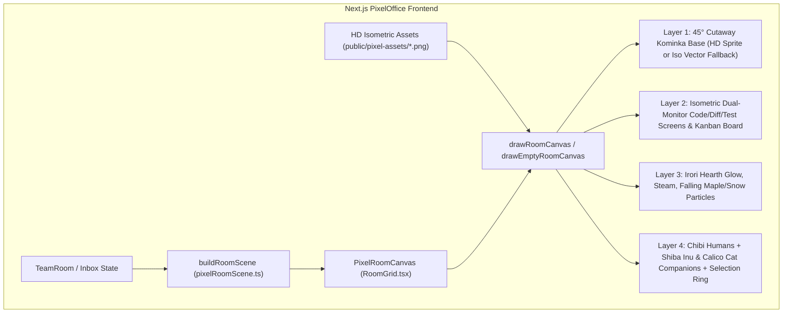

# 像素辦公室 45° 等距無前牆日系古民家高精細美術優化 Implementation Plan

> **For agentic workers:** REQUIRED SUB-SKILL: Use superpowers:subagent-driven-development to implement this plan task-by-task. Steps use checkbox (`- [ ]`) syntax for tracking.

**Goal:** 將像素辦公室升級為《日本田舎暮らし》風格的高精細 45° 等距無前牆剖面（Isometric Cutaway）日系古民家 × 極客工作室，包含三位 Q 版人類角色、柴犬與三花貓夥伴，以及即時動態 Canvas 特效圖層。

**Architecture:** 採用「高精細像素圖集（HD Pixel Art Diorama Base）＋ 60fps 即時動態 Canvas 圖層（螢幕程式碼／Diff 光效、地爐搖曳火光、咖啡蒸氣、四季窗外落葉／飄雪粒子、動物夥伴呼嚕與角色高亮／走動內插）」混合架構。當在無圖片載入的單元測試或首幀環境時，內建完整 2:1 等距無前牆多邊形幾何繪圖回退，確保零白屏與 100% 測試相容。

**Architecture Diagram:**

**Tech Stack:** Next.js 15 (Static Export), React 19, TypeScript, HTML5 Canvas 2D (`imageSmoothingEnabled = false`), Tailwind CSS, Vitest.

## Global Constraints

- 維持所有既有匯出介面相容：`LW`, `LH`, `PIXEL_SCALE`, `SPOT`, `SEAT_META`, `PERSONA_CATALOG`, `buildRoomScene`, `drawRoomCanvas`, `drawEmptyRoomCanvas`, `getPersonaRecentRecords`, `findActiveCriterionIndex`, `sortEventsDesc`。
- 新增匯出 `COMPANIONS`（赤柴 `shiba` 與三花貓 `calico` 夥伴定義）供測試與 UI 檢視。
- 畫布比例採 16:9 高精細邏輯座標 `LW = 240, LH = 135, PIXEL_SCALE = 4`（實體 `960×540` 像素），讓高清等距圖集與動態像素圖層銳利無模糊。
- 套用 `modern-web-guidance` 之 `efficient-background-processing`（`content-visibility: auto` 與 `contentvisibilityautostatechange` 離屏暫停動畫迴圈）。

---

### Task 1: 部署高清 45° 等距無前牆像素圖集並撰寫場景與夥伴單元測試

**Files:**
- Create: `pixeloffice/public/pixel-assets/iso-room-working.png`
- Create: `pixeloffice/public/pixel-assets/iso-room-lounge.png`
- Create: `pixeloffice/public/pixel-assets/iso-room-empty.png`
- Create: `pixeloffice/lib/pixelRoomScene.test.ts`

**Interfaces:**
- Consumes: `TeamRoom`, `InboxItem` from [`pixeloffice/lib/types.ts`](file:///d:/_AI_Projs/buttonAuto/pixeloffice/lib/types.ts)
- Produces: `COMPANIONS`, 45° isometric `SPOT` coordinates, and `buildRoomScene` companion & isometric scene state in [`pixeloffice/lib/pixelRoomScene.ts`](file:///d:/_AI_Projs/buttonAuto/pixeloffice/lib/pixelRoomScene.ts)

- [ ] **Step 1: Copy `iso-room-working.png` into `pixeloffice/public/pixel-assets/` and write `pixeloffice/lib/pixelRoomScene.test.ts`**
- [ ] **Step 2: Run `npm test` in `pixeloffice` to verify the new test fails before updating `pixelRoomScene.ts`**

---

### Task 2: 實作 `pixelRoomScene.ts` 45° 等距無前牆混合渲染引擎與柴犬／三花貓夥伴系統

**Files:**
- Modify: [`pixeloffice/lib/pixelRoomScene.ts`](file:///d:/_AI_Projs/buttonAuto/pixeloffice/lib/pixelRoomScene.ts)
- Test: `pixeloffice/lib/pixelRoomScene.test.ts`

- [ ] **Step 1: Update `LW = 240, LH = 135, PIXEL_SCALE = 4`, 45° isometric `SPOT` coordinates, and `COMPANIONS` (`shiba` & `calico`)**
- [ ] **Step 2: Implement HD isometric asset loader (`iso-room-working.png`, `iso-room-lounge.png`, `iso-room-empty.png`) + 45° cutaway isometric vector fallback (front two walls removed, wood & tatami floor, shoji window, irori hearth, dual-monitor wooden desks)**
- [ ] **Step 3: Implement live isometric overlays (angled screen code/diff/test effects, flickering irori firelight & radial glow, rising pour-over coffee steam, seasonal falling maple leaves / snow particles, Shiba tail wag / musical note, Calico cat sleeping `zZ`, and chibi human walking/selection ring)**
- [ ] **Step 4: Run `npm test` in `pixeloffice` to verify all unit tests pass**

---

### Task 3: 升級 `RoomGrid.tsx` 與 `OfficeTopBar.tsx` 日系古民家溫潤視覺、動物夥伴互動提示與離屏渲染優化

**Files:**
- Modify: [`pixeloffice/components/RoomGrid.tsx`](file:///d:/_AI_Projs/buttonAuto/pixeloffice/components/RoomGrid.tsx)
- Modify: [`pixeloffice/components/OfficeTopBar.tsx`](file:///d:/_AI_Projs/buttonAuto/pixeloffice/components/OfficeTopBar.tsx)

- [ ] **Step 1: Update `RoomGrid.tsx` to align speech bubbles & nameplates with the 45° isometric coordinates, add Shiba Inu & Calico Cat status badges/tooltips, apply warm Kominka wood-and-amber card styling, and add `content-visibility: auto` + `contentvisibilityautostatechange` pause/resume**
- [ ] **Step 2: Update `OfficeTopBar.tsx` with matching warm Japanese kominka studio header accents**
- [ ] **Step 3: Run `npm run build` in `pixeloffice` to export static bundle to `web/pixel/` and verify with `npm test`**
