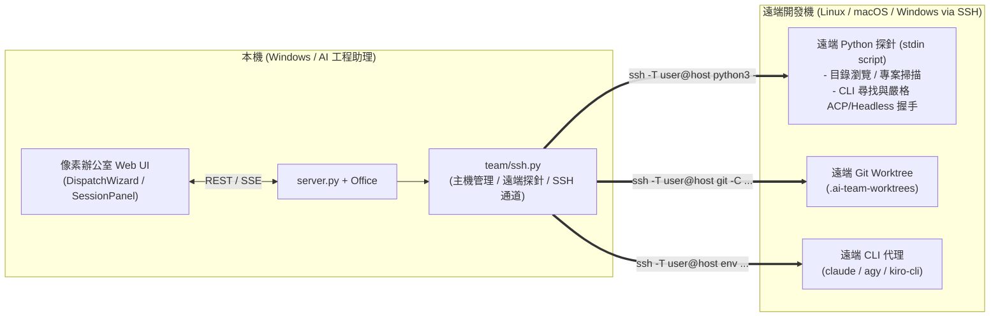

# SSH 遠端開發與遠端 CLI 嚴格握手偵測設計規格

日期：2026-11-18
狀態：待使用者核准（Draft for Review）

---

## 1. 目標與核心需求

為 `buttonAuto`（AI 工程助理／像素辦公室）加入 **SSH 遠端開發能力**，並對目標環境（本機或指定 SSH 遠端主機）上的三大 CLI（`claude`、`agy`、`kiro-cli`）執行**嚴格握手偵測（Handshake Probe）**：

1. **SSH 主機設定與連線**：
   - 自動解析本機 `~/.ssh/config`（支援 `Include`），列出所有非萬用字元的 `Host` 別名。
   - 支援在網頁介面手動新增／輸入 `user@host[:port]`（儲存於本機設定 `ssh_hosts.local.json`，gitignored）。
   - 底層走系統 OpenSSH（`ssh -T -o BatchMode=yes`），完整繼承使用者的 SSH Agent、金鑰、`ProxyJump` 與 `ControlMaster`。
2. **嚴格 CLI 可調用性偵測（不能調用的絕不顯示）**：
   - 針對指定目標主機（本機 `local` 或遠端 `ssh_host`），透過登入環境（Login Shell PATH ＋ 常見安裝路徑如 `~/.local/bin`、`~/.cargo/bin`、`/usr/local/bin`、`~/.nvm` 等）尋找 `claude`、`agy`、`kiro-cli`。
   - **嚴格握手判定**：
     - **`agy`（Antigravity CLI）與 `kiro`（Kiro CLI）**：啟動 `<cli> acp`（Kiro 帶 `acp --agent-engine v3 --auth-method cli`），完成 JSON-RPC `initialize` ＋ `session/new`，並取得可用模型清單（`availableModels` 或 `configOptions`）。若程序異常退出、未登入、回傳 JSON-RPC 錯誤或逾時，視為**不可調用**。
     - **`claude`（Claude CLI）**：實測執行最小無副作用探測（驗證執行檔可啟動且通過認證／可列出模型，不因未登入或損壞而失敗）。若本機同時具備有效的 `litellm.local.json`，且遠端 `claude` 執行檔可正常啟動，則將 `glm`／`glm_high` 視為可調用（執行時透過 SSH stdin/env 注入 LiteLLM 參數）。
   - **UI 嚴格過濾**：在派工精靈（[`DispatchWizard.tsx`](file:///d:/_AI_Projs/buttonAuto/pixeloffice/components/DispatchWizard.tsx)）、房間詳情面板（[`SessionPanel.tsx`](file:///d:/_AI_Projs/buttonAuto/pixeloffice/components/SessionPanel.tsx)）與車隊抽屜中，**只顯示該房間目標主機上通過嚴格握手的 CLI 座位與模型**；不能調用的 CLI 直接隱藏不顯示。
3. **全遠端執行（Full Remote Execution over SSH）**：
   - 專案位於遠端主機上：支援在網頁透過 SSH 瀏覽遠端目錄（`/api/team/dirs?ssh_host=...`）與掃描專案檢查指令（`/api/team/scan?ssh_host=...`）。
   - 遠端房間的 Git worktree 建立／差異檢查／合併（`gitops`）、CLI 代理對話（`AcpDriver`／`HeadlessDriver` stdio 透過 SSH 串流）、QA 測試關卡（`checks`）與 CE 計畫同步皆在遠端主機執行；本機負責像素辦公室 UI、收件匣、Decision-1／GLM 裁判調度。

---

## 2. 架構設計（方案 A：系統 OpenSSH 通道 ＋ 遠端單檔 Python 探針）



### 2.1 新增模組：`team/ssh.py`
負責所有 SSH 相關操作與遠端探針：
- **`SshHost` 資料結構**：
  - `id`: 主機識別碼（如 `"gpu-dev"` 或 `"ubuntu@192.168.1.50:2222"`）
  - `label`: 顯示名稱
  - `source`: `"ssh_config"` 或 `"custom"`
  - `host`, `user`, `port`, `identity_file`: 解析或自訂的連線資訊
- **`list_ssh_hosts()`**：
  - 讀取 `~/.ssh/config`（含遞迴展開同目錄或絕對路徑的 `Include`），擷取非 `*`/`?` 的 `Host` 名稱。
  - 合併 `ssh_hosts.local.json` 中使用者在網頁新增的主機。
- **`validate_ssh_target(target)`**：
  - 嚴格白名單檢驗（禁止 `-` 開頭避免 SSH Option Injection、禁止控制字元與空白），確保傳給 `ssh` 子程序的目標安全無虞。
- **`ssh_cmd(target, remote_argv_or_script)`**：
  - 統一建構 `["ssh", "-T", "-o", "BatchMode=yes", "-o", "ConnectTimeout=10", ...]`（若 `target` 含 `:port` 且非 IPv6，自動拆為 `-p <port> user@host`）。
- **遠端單檔探針（Remote Probe via `python3 -` / `python -`）**：
  - 不需要在遠端預先安裝任何套件或留存檔案，直接透過 `ssh -T <host> sh -lc 'python3 - || python -'` 從 `stdin` 送入內建標準庫 Python 腳本並回傳 JSON：
    1. **`remote_dirs(ssh_host, path)`**：回傳遠端目前路徑、上一層路徑、子資料夾清單（與本機 `/api/team/dirs` 結構一致）。
    2. **`remote_scan(ssh_host, path)`**：檢查遠端路徑是否為 Git repo、掃描子資料夾與 `pytest` / `npm test` / `cargo test` 等檢查指令，以及讀取 `docs/plans/*.md`。
    3. **`probe_remote_clis(ssh_host)`**：
       - 在遠端登入環境下展開 `PATH` 及常見 CLI 路徑（`~/.local/bin`, `~/.cargo/bin`, `/usr/local/bin`, `/opt/homebrew/bin`, `~/.nvm/versions/node/*/bin`, `~/.npm-global/bin` 等）。
       - 對找到的每個候選 CLI 並行執行**嚴格握手測試**（單一 CLI 逾時上限 12 秒）：
         - **`kiro` / `agy`**：啟動 ACP 子程序，送出 `initialize` 與 `session/new`（`cwd` 設為遠端暫存目錄），等待最多 3 秒收集 `availableModels` / `configOptions`，成功拿到 `sessionId` 且無錯誤才標記 `callable: True`，並一併回傳偵測到的模型清單 `models` 與 `current` 模型！
         - **`claude`**：檢查執行檔可執行，並以最小探測驗證 CLI 處於可調用狀態（同時擷取支援的模型清單）；若另外檢查 `claude_bin_ok: True`（執行檔可正常啟動 `--version`），供本機有 `litellm.local.json` 時啟用遠端 `glm` / `glm_high` 座位。
       - 快取與手動重刷：每個 `ssh_host` 的偵測結果快取於記憶體與 `<team_root>/remote_clis_cache.json`，支援在 UI 點擊「重新偵測」強制更新。

### 2.2 本機 CLI 同步套用嚴格過濾
- 本機模式（`ssh_host == ""`）同樣遵守「不能調用的就別顯示出來」：
  - 整合 `Office.detect_models` 與 `available_seats()`，當 CLI 握手失敗（例如未安裝、啟動崩潰或未登入導致握手失敗）時，從可選座位清單中隱藏，只顯示真正可調用的 CLI。

### 2.3 房間與執行器（Room / Drivers / GitOps / Checks）的遠端化
1. **`Room` 新增欄位（[`team/rooms.py`](file:///d:/_AI_Projs/buttonAuto/team/rooms.py)）**：
   - `ssh_host: str = ""`（空字串代表本機開發；非空代表遠端 SSH 主機，如 `"dev-box"` 或 `"user@10.0.0.5:22"`）。
2. **`team/gitops.py` 支援 `ssh_host`**：
   - `git(cwd, *args, ssh_host="")`：當 `ssh_host` 非空時，透過 `ssh` 在遠端 `cwd` 執行 `git -c core.quotepath=false ...`。
   - `create_worktree`、`changed_files`、`uncommitted`、`commits_since`、`diff_stat`、`diff_text`、`merge_into_repo`、`remove_worktree`、`ensure_local_git_repo` 皆支援傳入 `ssh_host`，在遠端檔案系統建立與管理 `.ai-team-worktrees`。
3. **`team/drivers.py`、`team/acp.py`、`team/headless.py` 支援 `ssh_host`**：
   - 當房間設定了 `ssh_host` 時：
     - `AcpDriver` 與 `HeadlessClaude` 的本機子程序改為啟動 `ssh -T <ssh_host> <remote_wrapper>`，在遠端切換至 `worktree` 目錄、設定環境變數（透過 stdin 安全傳遞 `SecretEnv`，**絕不把 `ANTHROPIC_AUTH_TOKEN` 等金鑰放在遠端 `ps aux` 可見的命令列參數中**），並以 `os.execvp` 啟動遠端 CLI。
     - 本機的 `AcpClient`（JSON-RPC over stdio）與 `HeadlessClaude`（stream-json over stdio）完全無縫透過 SSH 管線收發事件與權限請求！
     - 當本機觸發 `cancel()` 或 `close()` 時，除了關閉本機 `ssh` 子程序外，遠端包裝器偵測到 `stdin` EOF 會自動終止遠端 CLI 程序群組（`os.killpg`），避免在遠端留下孤兒程序。
4. **`team/checks.py` 支援 `ssh_host`**：
   - QA 關卡執行 `test_cmd` 與驗收條件的 `check` 指令時，若 `room.ssh_host` 非空，透過 SSH 在遠端 `worktree`（或遠端暫存複本）執行並取回 exit code 與輸出。

### 2.4 REST API 擴充（[`server.py`](file:///d:/_AI_Projs/buttonAuto/server.py)）
- `GET /api/team/ssh/hosts`：列出可用的 SSH 主機清單（`~/.ssh/config` ＋ 自訂主機）以及各主機目前已快取的 CLI 偵測狀態。
- `POST /api/team/ssh/hosts`：新增或刪除自訂 `user@host[:port]` 主機。
- `POST /api/team/ssh/probe`：對指定 `ssh_host`（或本機 `""`）執行連線測試與 `claude`、`agy`、`kiro` 嚴格握手偵測，回傳可調用的座位清單與各座位可用模型：
  ```json
  {
    "ok": true,
    "ssh_host": "gpu-server",
    "reachable": true,
    "available_seats": ["claude", "kiro", "glm", "glm_high"],
    "clis": {
      "claude": {"callable": true, "label": "Claude CLI", "path": "/home/user/.local/bin/claude", "models": [...]},
      "kiro": {"callable": true, "label": "Kiro CLI", "path": "/home/user/.local/bin/kiro-cli", "models": [...]}
    }
  }
  ```
  *（注意：握手失敗或未安裝的 `agy` 不會出現在 `available_seats` 與 `clis` 中）*
- `GET /api/team/dirs?path=...&ssh_host=...`：支援瀏覽遠端主機目錄。
- `GET /api/team/scan?path=...&ssh_host=...`：支援掃描遠端主機專案資料夾。
- `POST /api/team/rooms`：接受 `ssh_host` 參數，並驗證所選 `impl_cli`／`review_cli` 在該 `ssh_host` 上確實可調用。

### 2.5 前端介面更新（[`DispatchWizard.tsx`](file:///d:/_AI_Projs/buttonAuto/pixeloffice/components/DispatchWizard.tsx) ＆ [`SessionPanel.tsx`](file:///d:/_AI_Projs/buttonAuto/pixeloffice/components/SessionPanel.tsx)）
1. **開發環境切換（本機 vs. SSH 遠端主機）**：
   - 在「新增工作房間（派工精靈）」最上方加入「開發環境」選擇器：
     - `🖥️ 本機開發`
     - `🌐 SSH 遠端開發`（下拉選單列出 `~/.ssh/config` 主機，並提供「＋ 新增 `user@host`」輸入框與「重新偵測遠端 CLI」按鈕）。
2. **切換主機時自動執行嚴格偵測並過濾選項**：
   - 當選擇某台 SSH 遠端主機（或本機）時，自動呼叫 `/api/team/ssh/probe`（若有快取先顯示快取，也可點按鈕即時重測）。
   - **「實作 CLI 座位」與「審查 CLI 座位」下拉選單動態過濾**：
     - 只保留 `自動派工（Decision-1）` 以及該主機上 **`callable === true`** 的座位！
     - 若某個 CLI（例如 `agy` 或 `kiro`）在該遠端未安裝、未登入或握手失敗，**直接從下拉選單與可用列表中移除，完全不顯示**。
     - 若所有 CLI 在該遠端都不可調用，顯示明確提示（「此遠端主機未偵測到任何可調用的 CLI（claude / agy / kiro-cli），請確認遠端已安裝並完成登入」），並停用派工按鈕。
3. **房間卡片與詳情面板顯示 SSH 標籤**：
   - 遠端房間在標題旁顯示 `🌐 <ssh_host>` 徽章。
   - 在 `SessionPanel.tsx` 中切換座位與模型時，同樣只顯示該房間所屬 `ssh_host` 可調用的 CLI 與模型，並建置匯出靜態資源至 `web/pixel/`。

---

## 3. 安全性與錯誤處理

- **防參數注入（Argument Injection）**：所有 `ssh_host` 與遠端路徑皆經過嚴格格式驗證（拒絕以 `-` 開頭的 host，遠端命令統一透過 `python3 -` stdin JSON 封包傳遞參數，不拼接未轉義的 shell 字串）。
- **金鑰不落遠端磁碟、不進 `ps aux`**：GLM 座位的 `ANTHROPIC_AUTH_TOKEN` 透過 SSH stdin 啟動封包傳給遠端 Python wrapper 的 `os.environ`，不在命令列曝光，也不寫入遠端硬碟。
- **孤兒程序清理**：遠端 Python wrapper 監聽 stdin / 父程序狀態，一旦 SSH 斷線或房間暫停，立即向遠端 CLI 整個 process group 發送 `SIGTERM` -> `SIGKILL`。
